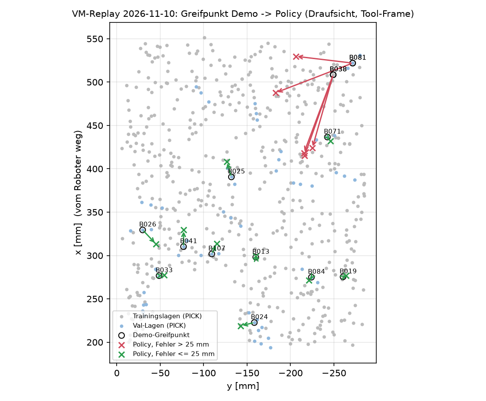

# Testprotokoll Modellprüfung – Checkpoint 2026-11-09

*Stand: 2026-11-10. Jeder Test steht mit Zweck, Vorgehen, Änderungen und Ergebnis da, damit er sich
für einen späteren Bericht nachvollziehen lässt. PDF: `Berichte/2026-11-10_Modellpruefung_Checkpoint_2026-11-09.pdf`.*

**Alle VM-Ergebnisse sind keine Anlagenmessung.** Jede Fahrt lief mit `is_robot_in_simulation() == True`
(VirtualBox-VM „Lara5_V5“, 192.168.2.13, Server v5.0.0-alpha.102, Client v5.0.8).

---

## 0. Ausgangslage

| | |
|---|---|
| Datensatz | `datasets/2026-11-09`: 602 Episoden, 82 591 Frames, Anlage (`in_simulation = false`), aus `data/2026-11-02` (83), `data/2026-11-03` (297), `data/2026-11-09` (222) |
| Objekt | nur „Lila-Objekt“, 164 Blöcke, 203 Wiederholungsgruppen |
| Variation | Licht: Decke an/aus + Fensterlicht; Kamera: nominal / leicht gedreht / stark gedreht (je Session) |
| Einheitlich | Override 0,5, servo_j 60 Hz, 15 Hz Regeltakt, Planer 0,15/0,05 m/s |
| Kameras | wrist + scene, Daheng, 240 × 320 |
| Training | `apps/train.py`, 10 000 Schritte, Batch 128, bf16, 4 Worker, lr 1e-4, RTX 5070 Ti, 77,5 min |
| Vorgeschichte | Erster Versuch mit Batch 192 brach nach ~400 Schritten mit Windows-Fehler 1455 ab (Commit-Limit: 32 GB RAM + 14 GB Auslagerung; 4 Worker × 2 vorgeladene Batches ≈ 5,7 GB geteilter Speicher). Batch 192 brachte nur ~10 % mehr Durchsatz als 64 (295 statt 270 Samples/s), daher Batch 128. |

---

## Test 1 – Trainingsverlauf (Offline-Validierung)

**Zweck:** Lernt das Modell, und überangepasst es (wie beim Lauf 2026-10-26 ab 6–14k Schritten)?

**Vorgehen:** `checkpoints/2026-11-09/train_log.csv`, Validierung alle 2000 Schritte. Nichts geändert.

| Schritt | Train-Loss | Val-Loss | Val Gelenk-MAE | Val Gelenk p95 | Greifer-Acc | Chunk-Sprung p95 |
|---:|---:|---:|---:|---:|---:|---:|
| 2 000 | 0,00117 | 0,00193 | 0,0225 rad | 0,0876 rad | 99,72 % | 0,170 rad |
| 4 000 | 0,00056 | 0,00052 | 0,0100 rad | 0,0357 rad | 99,75 % | 0,052 rad |
| 6 000 | 0,00033 | 0,00043 | 0,0086 rad | 0,0321 rad | 99,82 % | 0,042 rad |
| 8 000 | 0,00017 | 0,00032 | 0,0082 rad | 0,0316 rad | 99,97 % | 0,034 rad |
| 10 000 | 0,00011 | 0,00030 | 0,0081 rad | 0,0313 rad | 100,0 % | 0,034 rad |

Zum Vergleich der Lauf 2026-10-26 (167 Ep.) bei 60 000 Schritten: Val-Loss 0,00164, MAE 0,0110 rad.

**Ergebnis:** Val-Loss sinkt bis zum Schluss, keine Überanpassung erkennbar, rund 5× niedriger als
beim letzten Lauf. Speicher 9,6 GB VRAM. **Einschränkung:** Die Validierung ist Teacher Forcing
(echter Zustand + echte Bilder je Frame). Befund vom 2026-10-29: Nahe PICK verrät der Zustand das
Ziel, der Offline-Fehler sagt deshalb wenig darüber, ob die Policy eine *neue* Lage aus den Bildern
findet. Deshalb Test 3 ff.

---

## Test 2 – Train/Val-Aufteilung und Lagen-Leck

**Zweck:** Ist die Validierung wirklich „unbekannte Lage“, oder liegt dieselbe Lage auch im Training?

**Vorgehen:** `skripte/split_check.py`, `skripte/leak_check.py` (nur lesend). `train.py` teilt nach
`repeat_group` (Wiederholungen derselben Lage immer auf einer Seite). Geprüft wurde zusätzlich der
Abstand jeder Val-Lage (geteachter PICK-Punkt) zur nächsten Trainingslage.

**Ergebnis:**

* 60 Val-Episoden = 20 Wiederholungsgruppen. 5 Blöcke (alle 2026-11-09: B022, B024, B033, B039,
  B040) haben Varianten in Train UND Val; die Varianten liegen aber an anderer Stelle (s. u.).
* Nächste Trainingslage zu jeder Val-Lage: 0,7–14 mm in xy (Arbeitsraum ist dicht belegt), aber mit
  ähnlicher Drehung (< 10°) erst 6,5–67 mm entfernt (Median ≈ 17 mm).
* Arbeitsraum PICK: x 0,194–0,551 m, y −0,285 … −0,006 m, z 5–10 mm.

Die Val-Lagen sind echte neue Lagen, liegen aber zwischen bekannten (Interpolation, nicht
Extrapolation). Ausreißer: B026 (67 mm), B081 (46 mm, am Rand x = 0,52 m).

---

## Test 3 – VM-Replay, erster Probelauf (Werkzeug neu gebaut)

**Zweck:** Geschlossener Regelkreis ohne Anlage, wie am 2026-10-29. Das damalige Skript lag nur im
temporären Ordner und war weg – deshalb neu gebaut und diesmal im Projekt abgelegt:
**`tools/replay_vm.py`**.

**Prinzip:** Die Policy fährt die VM (`apps/infer.py` unverändert, per Einhängen erweitert). Die VM hat
weder Kamera noch Objekt; die Policy bekommt je Takt die **Anlagenbilder** der aufgezeichneten Episode
an der passenden Stelle. Tool-Versatz: Die VM hat kein Tool (TCP = Flansch), die Anlagendaten sind im
Tool-Frame. Der Versatz wird beim Start aus der Aufzeichnung selbst bestimmt (VM-FK für aufgezeichnete
Gelenkwinkel gegen aufgezeichnete TCP-Pose) und in `read_state` aufgeschlagen.
Bewertung gegen DIESE Demo: Greifpunkt (TCP beim ersten Schließen) und Endpunkt.

**Änderungen gegenüber `infer.py`:** Kameras = Replay; Kamera-Backend-Prüfung (Daheng ≠ Replay)
absichtlich ausgeblendet; `build_observation` setzt den Bildzeiger aus dem Zustand derselben
Beobachtung. Sonst alles wie `infer.py`: Override 0,5, servo_j 60 Hz, Chunks gemittelt, neu alle
2 Takte, asynchrone Vorhersage, Geofence-Tisch −0,145 m.

**Lauf 3a** (Val B081, Datensatz-Ep. 506, Bildzuordnung über Gelenkwinkel):
Tool-Versatz exakt [0; 0; 197,5] mm (Streuung 0,00 mm / 0,000°) – bestätigt den Befund vom 29.10.
Greifpunkt **48,9 mm** daneben (12 mm zu hoch), Ende 3,6 mm, Endstellung erreicht.
**Nach dem Greifen tauchte der TCP auf z = −57 mm ab** (Greifhöhe +9 mm) – an der Anlage wäre das
eine Tischkollision; der Geofence (−145 mm) hätte nicht ausgelöst.

**Fehler im Werkzeug gefunden:** `infer.py` wärmt die Policy *vor* der Fahrt zur Startstellung auf.
Diese Beobachtung (Arm 1,9 rad entfernt) schob den Bildzeiger auf Frame 40.
→ **Änderung:** Bildzeiger zu Beginn jeder Fahrt zurücksetzen (`run_episode` eingehängt).
Lauf 3a ist damit nur eingeschränkt gültig.

**Lauf 3b** (gleiche Lage, Zeiger-Reset, Zuordnung weiter über Gelenkwinkel):
Kein Greifen, Abbruch durch ServoGuard („Ziel 0,371 rad von der Ist-Stellung, Gelenk 5“) nach
163 Takten, z_min −6 mm. Bildzuordnung schlecht (Abstand p50 1,18 rad).

**Analyse (Lauf 3b, nur lesend):** Policy-Bahn gegen die Demo über die TCP-Position verglichen.
Die **Position** folgt der Demo bis zum Anflug auf 2–64 mm, aber **Gelenk 6 (Handgelenk) dreht
anders**: Abweichung wächst von 0 auf −0,27 rad (Takt 20) bis −1,57 rad (≈ 90°). Die Gelenk-
Zuordnung wurde von Gelenk 6 dominiert und lieferte Bilder von falschen Stellen.
→ **Änderung:** Bildzuordnung über die **TCP-Position** (gleicher Greiferzustand, Suchfenster 5 zurück /
40 voraus). Die Handgelenkdrehung wird stattdessen als eigene Kennzahl ausgewertet
(`grasp_dj6_deg`: Gelenk 6 am Greifpunkt minus Demo).

Die Probeläufe 3a/3b wurden nach der Änderung gelöscht; ihre Zahlen stehen nur hier.
Eine erste Serie mit dem Zeiger-Fehler wurde abgebrochen und ebenfalls verworfen.

---

## Test 4 – Greifdrehung in den Demonstrationen (Datenprüfung)

**Zweck:** Warum dreht die Policy das Handgelenk anders? Ist die Aufgabe in den Daten eindeutig?

**Vorgehen:** `skripte/yaw_check.py`, `skripte/yaw2.py` (nur lesend, alle 602 Episoden): Werkzeug-
Gierwinkel am Greifpunkt (aus der TCP-Quaternion) gegen `object_yaw_deg` der Lage.

**Ergebnis:**

* Werkzeug-Gierwinkel = Objekt-Gierwinkel **modulo 180°** exakt (Abweichung 0,0°) – die Lage wird
  sauber getroffen.
* Aber modulo 360°: Für Objekte mit **0–90°** greift die Hälfte der Demos um **180° gedreht**
  (140 × 0°, 144 × 180°). Für 90–180° praktisch nie (317 × 0°, 1 × 180°).
* Gelenk 6 am Greifpunkt: ohne Drehung +36…+163°, mit Drehung −119…−4°.
* Die Drehung hängt nicht eindeutig an Lage oder Winkel: Anteil gedreht je Winkelband 0–15°: 42/46,
  15–30°: 33/53, 30–45°: 22/41, 45–60°: 24/60, 60–75°: 20/46, 75–90°: 3/38; über y gleichmäßig
  ~50 %. Je Session: 11-02 39/44, 11-03 49/137, 11-09 56/103.

**Bewertung:** Für dasselbe Bild gibt es in den Daten zwei „richtige“ Handgelenkstellungen, 180°
auseinander (beim Parallelgreifer gleichwertig). Die Diffusion Policy kann zwei Modi abbilden, aber
`infer.py` **mittelt überlappende Chunks** (`ChunkEnsembler`, decay 0). Mittelt es Vorhersagen aus
beiden Modi, landet das Handgelenk dazwischen, also um ~90° falsch – das passt zu Lauf 3b
(−80…−90°). **Hypothese, noch nicht bestätigt** – siehe Test 5 und 6.

---

## Test 5 – VM-Replay-Serie (8 unbekannte, 3 bekannte Lagen)

**Zweck:** Greift die Policy im geschlossenen Kreis an unbekannten Lagen richtig?

**Vorgehen:** `tools/replay_vm.py` mit Zeiger-Reset und Zuordnung über die TCP-Position (Stand nach
Test 3). Zufallsauswahl mit Seed 1: je Wiederholungsgruppe die erste Episode, 8 aus den 20 Val-Gruppen,
3 aus den Trainingsgruppen. Sonst nichts geändert.

```
python tools/replay_vm.py --checkpoint checkpoints/2026-11-09/policy --dataset datasets/2026-11-09 \
    --val 8 --train 3 --seed 1 --out checkpoints/2026-11-09/rollouts/2026-11-10_vm_replay_policy
```

**Kennzahlen:** *Greif* = Abstand TCP beim ersten Schließen zum Greifpunkt der Demo (3D), *xy* nur
waagrecht, *dj6* = Gelenk 6 am Greifpunkt minus Demo, *Ende* = Endposition gegen Demo,
*z_min* = tiefster TCP-Punkt der Fahrt (Demo-Greifhöhe 7–9 mm), *Bild95* = 95-%-Wert des Abstands
zwischen TCP und dem Demo-Frame, dessen Bilder die Policy bekam (Güte der Replay-Näherung).
*Erfolg* = Greif ≤ 10 mm UND Ende ≤ 10 mm UND Endstellung erreicht (Kriterium wie `infer.py`).

| Art | Block | Objekt-yaw | x / y [m] | Greif | xy | dj6 | Ende | z_min | Bild95 | Erfolg | Stopp |
|---|---|---:|---|---:|---:|---:|---:|---:|---:|---|---|
| val | B024 | 153° | 0,223 / −0,158 | 16 | 16 | +24° | 4 | 7 | 65 | nein | Endstellung |
| val | B033 | 173° | 0,277 / −0,049 | 8 | 6 | −21° | 6 | 6 | 41 | **ja** | Endstellung |
| val | B025 | 113° | 0,391 / −0,132 | 18 | 18 | −8° | 2 | −7 | 92 | nein | Endstellung |
| val | B026 | 50° | 0,329 / −0,030 | 24 | 22 | +2° | 2 | −2 | 71 | nein | Endstellung |
| val | B041 | 143° | 0,310 / −0,077 | 20 | 19 | +2° | 5 | 2 | 40 | nein | Endstellung |
| val | B071 | 160° | 0,437 / −0,242 | 6 | 6 | −8° | 3 | 6 | 17 | **ja** | Endstellung |
| val | B084 | 50° | 0,275 / −0,224 | 5 | 5 | −3° | 2 | 5 | 20 | **ja** | Endstellung |
| val | B107 | 145° | 0,302 / −0,109 | 15 | 13 | −9° | 4 | 1 | 43 | nein | Endstellung |
| train | B013 | 5° | 0,298 / −0,160 | 9 | 1 | −5° | 4 | −2 | 67 | nein | max_steps (Ende 4 mm, Halt nicht erkannt) |
| train | B019 | 160° | 0,275 / −0,260 | 6 | 4 | +3° | 3 | 5 | 34 | **ja** | Endstellung |
| train | B038 | 41° | 0,508 / −0,249 | 98 | 96 | −3° | 527 | −15 | 97 | nein | ServoGuard (Gelenk 6, 0,364 rad) |

Alle Werte in mm, wo nicht anders angegeben.

**Ergebnis:**

* Unbekannte Lagen: **8/8 bis zur Endstellung**, kein ServoGuard-Abbruch, kein tiefes Abtauchen
  (z_min ≥ −7 mm). Greiffehler xy 5–22 mm, Median 15 mm; 3/8 innerhalb 10 mm.
* Handgelenk am Greifpunkt meist ±10°, zweimal ±21–24°. **Kein 90°-Fehler wie in Lauf 3b** –
  auch nicht bei den beiden Lagen im mehrdeutigen Bereich (B026, B084, je 50°).
* Bekannte Lagen: B019 und B013 greifen auf 1–4 mm xy, **B038 (x = 0,508 m) greift 96 mm daneben**.
* Übergabepunkt (Ende) 2–6 mm bei allen, die ankamen.

---

## Test 6 – Nachtest der Ausreißer B081 und B038 (je 2 Wiederholungen)

**Zweck:** (a) B081 aus Test 3 war nicht in der Serie – zeigt sich der 90°-Fehler mit der korrigierten
Bildzuordnung noch? (b) Ist der Fehlgriff an der Trainingslage B038 reproduzierbar?

**Änderung:** `tools/replay_vm.py` um `--episodes` erweitert (Datensatz-Episoden direkt wählen).
Sonst wie Test 5.

```
python tools/replay_vm.py ... --episodes 506,377 --out .../2026-11-10_vm_replay_nachtest_a   (und _b)
```

| Lauf | Art | Block | Greif | xy | dj6 | Ende | z_min | Bild95 | Stopp | Greifpunkt Policy − Demo |
|---|---|---|---:|---:|---:|---:|---:|---:|---|---|
| a | val | B081 | 99 | 95 | −81° | 302 | **−56** | 135 | ServoGuard (Gelenk 5) | dx −34, dy +89, dz −26 |
| b | val | B081 | 68 | 66 | −59° | 7 | 8 | 111 | Endstellung | dx +8, dy +66, dz +16 |
| a | train | B038 | 88 | 88 | −4° | 9 | −7 | 66 | Endstellung | dx −85, dy +24, dz −8 |
| b | train | B038 | 100 | 99 | +15° | 2 | −14 | 57 | Endstellung | dx −93, dy +33, dz −15 |

**Ergebnis:**

* B081 (val, x = 0,522 m, yaw 58°): wieder Handgelenk 59–81° falsch, Greifpunkt 66–95 mm daneben,
  einmal Abtauchen auf −56 mm mit ServoGuard-Abbruch. Der Fehler aus Test 3 ist also **kein reines
  Werkzeug-Artefakt**.
* B038 (train, x = 0,508 m, yaw 41°): in 3 von 3 Fahrten (Test 5 + 6) **gleicher Fehler**, die Policy
  greift ~9 cm zu nah am Roboter (x ≈ 0,415–0,425 m). Das betrifft eine Lage, die im Training war.
* Beide Ausreißer liegen am **fernen Rand** (x > 0,5 m) und im mehrdeutigen Winkelbereich 0–90°.
  Am Datenmangel liegt es nicht: x 0,50–0,55 m enthält 77 Episoden (andere 5-cm-Bänder: 79–97).
* Zur Hypothese aus Test 4: Der Drehfehler tritt nur bei B081 auf, nicht bei B038 und nicht bei den
  mittigen Lagen im Bereich 0–90°. Weder bestätigt noch widerlegt.



*Draufsicht aller Fahrten aus Test 5 und 6. Kreis = Greifpunkt der Demo, Kreuz = Policy, Pfeil =
Abweichung. Grün ≤ 25 mm, rot > 25 mm. Grau/blau = PICK-Punkte aller Trainings-/Val-Episoden.*

---

## Test 7 – Tischabstand und Bildsprünge (Nachfrage Anwender)

**Zweck:** (a) Wäre die Policy an der Anlage in den Tisch gefahren? z_min aus Test 5/6 ist absolut;
der Tisch ist leicht schräg. (b) Erzeugt die Bildzuordnung Sprünge, die die Fahrt unruhig machen?

**Vorgehen:** `skripte/tisch_und_ruckeln.py` (nur lesend). Tischebene aus den Metadaten der jeweiligen
Demo (`table`: z = a·x + b·y + c, an der Anlage über 9 Punkte eingemessen, Restfehler 0,4 mm).
Geprüft gegen `pick_over_table_m`: Demo-Greifpunkt 8,8 mm über dem Tisch, Metadaten 8,6 mm – passt.
Für jede Fahrt der tiefste TCP-Punkt über der Tischfläche an seiner xy-Stelle. Bildsprünge = Takte,
in denen der Bildzeiger um mehr als 3 Frames springt.

| Lauf | Art | Block | Demo über Tisch | tiefster Punkt über Tisch | Takt | Phase | Bildsprünge > 3 |
|---|---|---|---:|---:|---:|---|---:|
| 6a | val | B081 | 8,8 | **−56,5** | 114 | nach dem Griff | 7 |
| 6a | train | B038 | 8,7 | **−6,3** | 94 | vor dem Griff | 7 |
| 6b | val | B081 | 8,8 | 8,1 | 87 | vor dem Griff | 5 |
| 6b | train | B038 | 8,7 | **−13,4** | 94 | vor dem Griff | 7 |
| 5 | val | B024 | 8,9 | 9,0 | 74 | am Griff | 3 |
| 5 | val | B033 | 9,0 | 7,1 | 89 | nach dem Griff | 4 |
| 5 | val | B025 | 8,6 | **−8,0** | 120 | nach dem Griff | 4 |
| 5 | val | B026 | 8,5 | −0,9 | 110 | vor dem Griff | 4 |
| 5 | val | B041 | 8,6 | 2,9 | 74 | am Griff | 9 |
| 5 | val | B071 | 8,7 | 6,4 | 92 | nach dem Griff | 5 |
| 5 | val | B084 | 8,8 | 6,8 | 76 | vor dem Griff | 1 |
| 5 | val | B107 | 8,7 | 2,0 | 74 | nach dem Griff | 4 |
| 5 | train | B013 | 8,6 | −0,4 | 97 | am Griff | 5 |
| 5 | train | B019 | 8,8 | 6,5 | 97 | nach dem Griff | 4 |
| 5 | train | B038 | 8,7 | **−14,2** | 92 | vor dem Griff | 8 |

Werte in mm (TCP im Tool-Frame).

**Ergebnis:**

* **6 von 15 Fahrten unterschreiten die Tischfläche**: deutlich bei B081 (−56 mm), B038 (−6 bis −14 mm,
  3/3) und B025 (−8 mm); knapp bei B026 und B013 (≈ −1 mm, Berührung). An der Anlage hätte der Tisch
  den Greifer dort aufgehalten – je nach Kraft Kollision bzw. Schutzstopp. Die VM kennt keinen Tisch
  und fährt durch.
* Die anderen 9 bleiben 2–9 mm über dem Tisch (Demo: 8,6–9,0 mm).
* Bildsprünge gibt es in jeder Fahrt (1–9). Sie sind ein Artefakt des Replays: An der Anlage kommen
  die Bilder fortlaufend von der Kamera. Ob sie die Fahrt hier unruhiger machen, ist mit dieser
  Auswertung nicht getrennt messbar; die Ruckeligkeit selbst wurde in diesem Test nicht gemessen.
* Folgerung für die Anlage: Der Geofence muss auf die Tischfläche (z. B. Tischebene + wenige mm)
  statt −145 mm, sonst schützt er hier nicht.

---

## Gesamtbewertung

**Gegenüber dem Checkpoint 2026-10-26 deutlich besser.** Damals: gelernte Lagen 4–5 mm, unbekannte
4–211 mm, zwei ServoGuard-Abbrüche, Abtauchen bis −72 mm. Jetzt: unbekannte Lagen in der Mitte des
Arbeitsraums 5–22 mm, alle kommen an, kein Abtauchen.

**Noch nicht anlagenreif:**

1. **Greifgenauigkeit:** Median 15 mm xy an unbekannten Lagen; nur 3/8 innerhalb 10 mm. Ob 15 mm beim
   Lila-Objekt zum Greifen reichen, hängt von Objekt- und Fingerbreite ab – an der Anlage klären.
2. **Ferner Rand (x > 0,5 m):** reproduzierbare Fehlgriffe um 7–10 cm, auch an einer Trainingslage,
   einmal mit Abtauchen auf −56 mm. Vor einer Anlagenfahrt dort nicht fahren bzw. Ursache klären.
3. **Mehrdeutige Greifdrehung (Test 4):** Für Objekte mit 0–90° sind die Demos zur Hälfte um 180°
   gedreht. In der Mitte stört das nicht (B026, B084 je ±3°). Bei B081 dreht das Handgelenk um 59–81°
   falsch – das passt zur Mittelungs-Hypothese, ist aber nicht bewiesen; bei B038 stimmt die Drehung
   (−4…+15°) und nur die Position ist falsch. Ob die Mehrdeutigkeit die Randfehler verursacht, ist
   **offen**. Unabhängig davon für künftige Aufnahmen: eine feste Regel beim Teachen (z. B. immer die
   Drehung mit Gelenk 6 im selben Bereich). Für die vorhandenen Daten wäre ein Vergleichstraining nur
   mit einer Variante der Test dafür.
4. **Tisch und Geofence (Test 7):** 6 von 15 Fahrten gehen unter die Tischfläche, 4 davon deutlich
   (−6 bis −56 mm). Der Geofence steht bei −0,145 m (`ideal_z_min − 0,15`) und hätte keine davon
   gestoppt. Er muss vor einer Anlagenfahrt an die eingemessene Tischebene.

**Grenzen dieses Tests:** Die Policy sieht Bilder der Demo an der nächstgelegenen Stelle, nicht aus
ihrer tatsächlichen Stellung. Je weiter sie abweicht, desto schlechter die Näherung (Bild95 bis
135 mm bei den Ausreißern). Fehler am Rand können deshalb teilweise vom Werkzeug verstärkt sein. Die
VM hat kein Objekt und keinen Kontakt, und `is_robot_in_simulation()` war True: **keine
Anlagenmessung.** Stichprobe klein (8 + 3 Lagen, 2 Nachtests).

---

## Dateien

| Was | Wo |
|---|---|
| Replay-Werkzeug | `tools/replay_vm.py` (neu) |
| Prüfskripte | `Berichte/2026-11-10_Modellpruefung_Checkpoint_2026-11-09/skripte/`: `split_check.py`, `leak_check.py` (Test 2), `yaw_check.py`, `yaw2.py` (Test 4), `replay_auswertung.py` (Tabellen Test 5/6), `tisch_und_ruckeln.py` (Test 7), `greifpunkte_bild.py` (Bild), `md_zu_pdf.py` (dieses PDF) |
| Fahrten Test 5 | `checkpoints/2026-11-09/rollouts/2026-11-10_vm_replay_policy/` (je Fahrt `summary.json`, `rollout_000.npz`, `replay_trace.json`; gesamt `replay_summary.json`) |
| Fahrten Test 6 | `checkpoints/2026-11-09/rollouts/2026-11-10_vm_replay_nachtest_a/` und `_b/` |
| Konsolenausgaben | gleichnamige `.log`-Dateien in `checkpoints/2026-11-09/rollouts/` |
