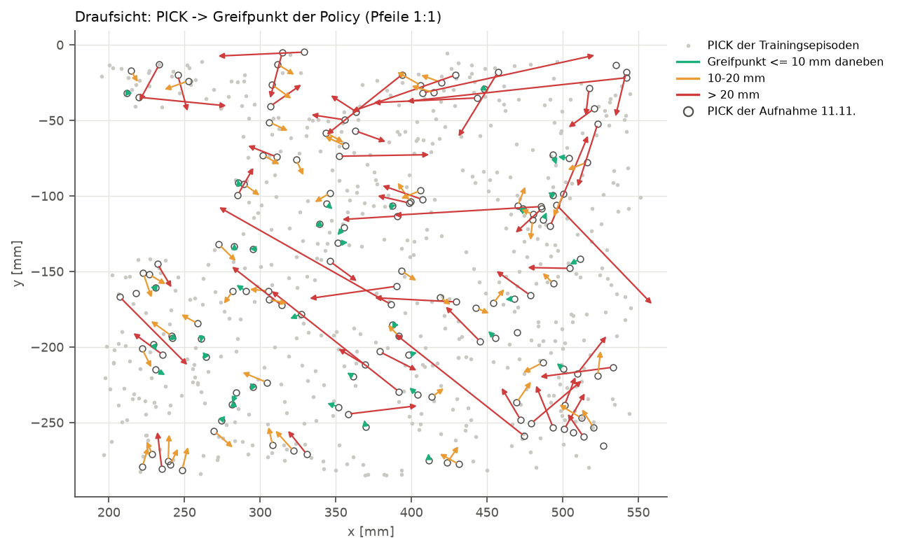
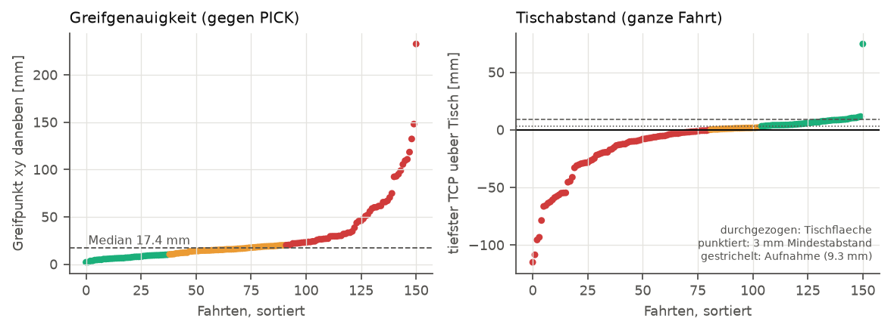
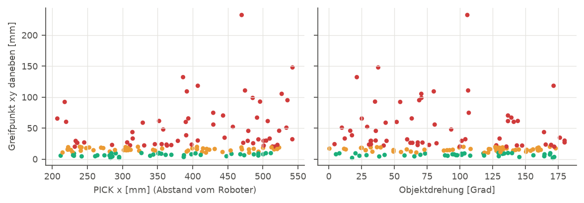
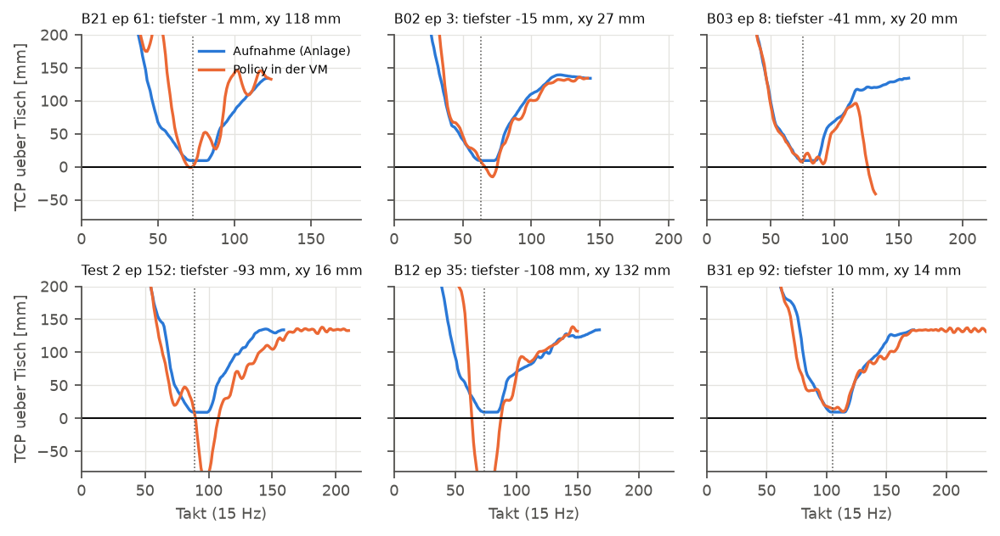
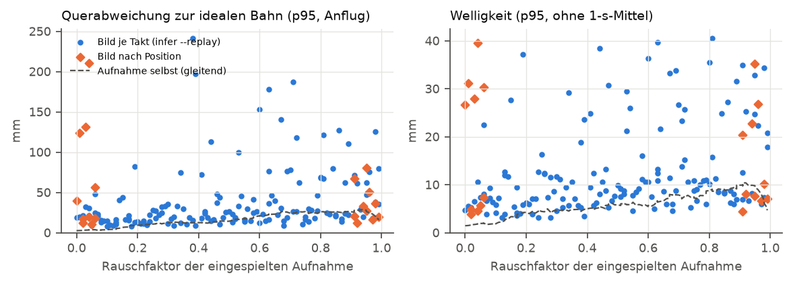

# Testprotokoll VM-Replay – Checkpoint 2026-11-09 mit den Aufnahmen vom 11.11.

*Stand: 2026-11-13. Grundlage vor dem ersten realen Policy-Test. Jeder Test steht mit Zweck, Vorgehen und
Ergebnis da. PDF: `Berichte/2026-11-13_VM-Replay_Daten-2026-11-11.pdf`.*

**Alle VM-Ergebnisse sind keine Anlagenmessung.** Jede Fahrt lief mit `is_robot_in_simulation() == True`
(VirtualBox-VM „Lara5_V5“, 192.168.2.13, Server v5.0.0-alpha.102, Client v5.0.8). Die VM hat keinen Tisch,
kein Objekt und keinen Greifer (Greiferbefehl wird nur protokolliert).

---

## Kurzfassung

| Frage | Antwort aus der VM |
|---|---|
| Wie genau wird der Greifpunkt getroffen? | Nächste Annäherung an den PICK-Punkt rund um das Schließen: **Median 10,7 mm**, 49 % innerhalb 10 mm, 90 % innerhalb 39 mm. Im Takt des Schließens selbst Median 17,4 mm (Zeitversatz, s. Test 4). Drehung um die Hochachse Median 8°, 17 % über 20°. |
| Würde er in den Tisch fahren? | **Ja, in gut der Hälfte der Fahrten.** 81 von 151 Fahrten gehen unter die Tischfläche, 46 tiefer als 10 mm, 16 tiefer als 50 mm. Meist kurz **nach** dem Schließen (der Arm zieht seitlich los, bevor er anhebt). Mit Bildwahl nach Position (Test 6) dasselbe Bild (9/20) – kein reines Testartefakt. |
| Schützt der Geofence? | **Mit diesem Checkpoint nicht.** `bc_policy.json` enthält noch keine Tischdaten; `infer.py` fällt auf −145 mm zurück und stoppt erst, wenn die Werkzeugspitze rund 55 mm *unter* dem Tisch ist. `--table-z` nahe 0 hilft nicht: Der Tischquader wird mit 6-cm-Hüllkugel + 3 cm Abstand geprüft und würde jeden Griff stoppen (Test 8). |
| Woher kommen die Schwingbahnen? | Überwiegend aus dem Test selbst: Die eingespielten Bilder zeigen die **verrauschte** Bahn der Aufnahme, der VM-Arm ist aber woanders. Die Policy „korrigiert“ Abweichungen, die es nicht gibt. Offline (Bild und Zustand passend) sind die Vorgaben so glatt wie die Labels. Ein Rest bleibt auch bei rauschfreien Aufnahmen (Test 7). |
| Unterschied Licht an/aus? | Nicht nachweisbar. Licht ist in allen Daten fest an Session und Kameradrehung gekoppelt; gleiche Bedingungen (Licht aus, stark gedreht) liefern am neuen Tag dasselbe wie an einem Trainingstag (10,5 vs. 10,0 mm, Test 9). |

---

## 0. Ausgangslage und Git-Stand

| | |
|---|---|
| Repo | `E:\Projekt\ProjektMaster_DynamicPicking`, M4 unter `code/m4_behavior_cloning`; Stand nach `git pull`: `18d98fa Offline Inferenztest` |
| Neu seit 10.11. (für diesen Test) | `apps/replay_check.py` (Stufe 1), `apps/infer.py --replay` mit `bc/replay.py`, `bc/adapters/cam_replay.py` (Stufe 2); außerdem Hindernisse, Rauschen im Anflug, lokale FK mit Tool-Versatz, Tischfläche im Kollisionsmodell |
| Konflikt mit eigenen Dateien | **Keiner.** Nicht versioniert sind nur `tools/replay_vm.py` (Prüfung 10.11.), der Bericht vom 10.11. und `data/`; keine der gezogenen Dateien liegt auf diesen Pfaden. |
| Checkpoint | `checkpoints/2026-11-09/policy` (10 000 Schritte, 602 Episoden vom 02./03./09.11.) |
| Neue Aufnahme | `data/2026-11-11`: 154 Episoden (3 verworfen: 2× Latenzbudget, 1× Schleppfehler), 10:58–14:55 Uhr, Lila-Objekt, Rauschfaktor 0–0,99 (gestaffelt), 52 Lagen à 3 Wiederholungen, PICK 8,9–9,2 mm über dem Tisch. **Nicht im Training.** |
| Hinweis | Die Episodenordner waren zunächst leer (OneDrive); nach erneutem Kopieren vollständig (5,8 GB). |

**Lage der neuen Objekte zum Training** (`skripte/data1111.py`): alle 52 Lagen im Bereich der Trainingsdaten
(x 212–535 mm, y −281…−5 mm). Nächste Trainingslage in xy Median 7 mm (max. 18 mm); mit ähnlicher Drehung
(< 15°) Median 15 mm. Die Lage „Test 2“ ist identisch mit einer Trainingslage (0 mm, 0°). Der Test prüft also
**Interpolation**, keine Extrapolation.

**Bedingungen:** 150 Episoden „Decke aus + Fensterlicht“, Kamera „stark gedreht“ (wie 09.11. im Training);
nur die 4 „Test“-Episoden mit Decke an / „gedreht“.

---

## Test 1 – VM ohne Tool: Tool-Versatz nötig

**Zweck:** Liefert der neue Replay-Weg (`infer.py --replay`) in der VM denselben Zustand wie an der Anlage?

**Vorgehen:** `skripte/vm_probe.py` (nur lesen).

**Ergebnis:** VM: `is_robot_in_simulation() = True`, Tool „NoTool“, lokale FK aktiv mit Versatz 0. Die
Aufnahmen sind im Tool-Frame (ZimmerLWR50). Ohne Korrektur sähe die Policy einen TCP 197,5 mm über dem
gewohnten. **Lösung ohne Repo-Änderung:** `skripte/stufe2_vm.py` ruft `infer.main()` unverändert auf und setzt
nach dem Verbinden nur `_tool_offset` der lokalen FK auf den aus der Aufnahme bestimmten Versatz
(0 / 0 / 197,5 mm, Streuung < 0,001 mm). Alle Prüfungen von `infer.py` bleiben aktiv.

---

## Test 2 – Stufe 1 offline (`apps/replay_check.py`)

**Zweck:** Trifft die Policy die Bahn, wenn Bilder **und** Zustand aus der Aufnahme kommen?

**Vorgehen:** `apps/replay_check.py --data data/2026-11-11 --episodes alle --plot`. Nach 16 Episoden
abgebrochen (≈ 40 s je Episode, 151 Episoden ≈ 100 min) – die Werte waren einheitlich und die VM-Reihe wichtiger.
Ausgabe: `checkpoints/2026-11-09/policy/replay_check/2026-11-13_daten-2026-11-11/` (npz + png je Episode).

**Ergebnis:** Gelenkfehler je Takt Median 0,7–1,8°, p95 2,1–5,0°, max. 6,6°. Greiferwechsel in allen 16
Episoden **im selben Takt** wie in der Aufnahme. Die Policy ist auf diesen ungesehenen Lagen offline sauber.
Einschränkung wie am 29.10. festgestellt: Nahe PICK verrät der Zustand das Ziel, Stufe 1 überschätzt die Güte.

---

## Test 3 – Stufe 2 in der VM, alle 151 Episoden

**Zweck:** Hauptfrage – Greifpunkt und Tisch im geschlossenen Kreis.

**Vorgehen:** `skripte/stufe2_vm.py --robot neura --checkpoint checkpoints/2026-11-09/policy --replay
data/2026-11-11 --replay-episode alle`. Override 0,5, servo_j 60 Hz, Chunks gemittelt (neu alle 2 Takte),
Vorhersage asynchron (Median 83 ms). Je Fahrt Start in der Startstellung der Episode, je Regeltakt ein Bild.
Auswertung `skripte/eval_stufe2.py` gegen den **PICK-Punkt der Episode** (object_pose) und gegen die
**eingemessene Tischfläche der Episode** (meta `table`, Ebene aus 9 Punkten, Restfehler 0,4 mm).
Fahrten: `checkpoints/2026-11-09/policy/rollouts/2026-11-13_vm_replay_daten-2026-11-11/`
(`summary.json`, `rollout_XXX.npz`, `auswertung.json`, `schwingen.json`).

| Kennzahl | Wert |
|---|---|
| Fahrten / Endstellung erreicht | 151 / 93 |
| Ende nicht erkannt (max. Takte): TCP 3–7 mm vor der Endstellung, aber Gelenk 6 im Median 1,7° daneben (Toleranz 1,15°) – kein Sicherheitsthema | 36 |
| ServoGuard-Abbruch (Ziel > 0,35 rad von der Ist-Stellung) | 22 – alle **nach** dem Greifen (Median 43 Takte danach), Gelenk 2 und 5 je 8× |
| Greifer geschlossen | 151/151, immer im Takt der Aufnahme (s. Test 4) |
| Greifpunkt xy im Schließtakt | Median 17,4 mm, p90 65 mm; ≤ 10 mm: 38, > 20 mm: 60 |
| **Nächste Annäherung an PICK (±15 Takte)** | **Median 10,7 mm, p90 38,7 mm; ≤ 10 mm: 74 (49 %)** |
| Drehung um die Hochachse beim Schließen | Median 8,3°, p90 24,6°; > 20°: 25 |
| TCP über Tisch beim Schließen | Median 6,9 mm (Aufnahme ≈ 9 mm), p10 −3,2 mm |
| Streuung derselben Lage (3 Wiederholungen) | Median 20 mm, p90 93 mm |
| Vorhersage / Takt-Überläufe | 83 ms Median / 13 Fahrten mit Überlauf |

*Draufsicht: Kreis = PICK der Episode, Pfeil = Greifpunkt der Policy im Schließtakt. Grün ≤ 10 mm, orange
10–20 mm, rot > 20 mm. Grau = PICK aller Trainingsepisoden.*

*Kein klarer Zusammenhang mit Abstand vom Roboter oder Objektdrehung; die großen Fehler verteilen sich über den
ganzen Arbeitsraum (anders als am 10.11., wo nur der ferne Rand auffiel).*

---

## Test 4 – Greifzeitpunkt kommt aus dem Bild

**Befund:** In allen 151 Fahrten schließt der Greifer exakt im Takt der Aufnahme (Versatz 0). Mit „ein Bild
je Takt“ sieht die Policy im Handgelenkbild, wann die Finger in der Aufnahme schließen, und folgt dem.
Liegt der Arm zeitlich hinter der Aufnahme (Median +3 Takte, p10/p90 −6/+12), schließt der Greifer, bevor
er am Objekt ist. Deshalb ist der Fehler im Schließtakt (17,4 mm) größer als die nächste Annäherung
(10,7 mm). **Für die Anlage:** Dort entscheidet die Policy den Zeitpunkt aus dem echten Bild; dieser Teil ist
in der VM nicht prüfbar. In Test 6 (Bild nach Position) schließt die Policy ohne diesen Hinweis: Versatz −15
bis +12 Takte, Annäherung trotzdem 14–16 mm.

---

## Test 5 – Tisch: wann und wie tief

**Vorgehen:** `skripte/tisch_detail.py`. Tiefster TCP-Punkt über der Tischfläche an seiner xy-Stelle.

| Tiefster Punkt | Fahrten (von 151) |
|---|---:|
| unter +3 mm (Mindestabstand) | 104 |
| unter 0 (Tischfläche) | 81 |
| unter −10 mm | 46 |
| unter −50 mm | 16 |
| tiefster Wert | −115 mm |

| Phase des tiefsten Punkts (nur Fahrten unter Tisch) | Fahrten | Median |
|---|---:|---:|
| vor dem Greifen (zu früh / zu tief abgesenkt) | 10 | −18 mm |
| am Greifen (±3 Takte) | 17 | −2,4 mm |
| **nach dem Greifen** | **54** | **−18 mm** |

Nach dem Greifen liegt der tiefste Punkt im Median **10 Takte (0,7 s) nach dem Schließen und 6 cm seitlich
vom PICK** – die Policy fährt seitlich los, bevor sie anhebt; die Aufnahme verweilt 0,5 s und hebt dann
senkrecht an. Je größer der Greiffehler, desto häufiger unter Tisch (≤ 10 mm: 11/37, > 50 mm: 21/24).

*Höhe der Werkzeugspitze über der Tischfläche, Aufnahme (blau) gegen Policy (orange), gepunktet = Schließtakt.
Typen: zu früh tief (B12), nach dem Greifen weiter abgesenkt (Test 2), Absturz im Transport (B03).*

**An der Anlage** hielte der Tisch den Greifer (mit Objekt) dort auf – Kollision bzw. Schutzstopp.

---

## Test 6 – Gegenprobe: Bild nach Position statt nach Takt

**Zweck:** Sind Greiffehler, Tischfahrten und Schwingen Artefakte der Bildwahl „ein Bild je Takt“?

**Vorgehen:** `BILDWAHL=position skripte/stufe2_vm.py …` – je Takt das Aufnahmebild, dessen Ist-TCP der
aktuellen VM-Stellung am nächsten liegt (gleicher Greiferzustand, Fenster −5/+40 Bilder). 20 Episoden aus 20
Lagen: 10 mit Rauschfaktor 0–0,06, 10 mit 0,91–0,99. Ordner `…/2026-11-13_vm_replay_positionswahl/`.

| gleiche 20 Episoden | Bild je Takt | Bild nach Position |
|---|---:|---:|
| nächste Annäherung, Rauschen niedrig / hoch | 13,6 / 13,5 mm | 14,1 / 15,5 mm |
| unter Tisch | 13 | 9 |
| ServoGuard-Abbruch | 3 | 6 |
| Querabweichung p95, Rauschen niedrig / hoch | 21,6 / 42,5 mm | 29,6 / 29,8 mm |
| Welligkeit, Rauschen niedrig / hoch | 6,0 / 16,6 mm | 17,1 / 9,1 mm |

**Ergebnis:** Greifgenauigkeit (≈ 14 mm) und Tischfahrten (9–13 von 20) hängen **nicht** an der Bildwahl –
sie sind Eigenschaften der Policy im geschlossenen Kreis. Die Bildwahl nach Position hat eigene Schwächen
(Bild und Arm schaukeln sich bei ruhigen Aufnahmen auf), sie ist kein besserer Test, nur eine Gegenprobe.

---

## Test 7 – Woher kommen die Schwingbahnen? (Nachfrage Anwender)

**Hypothesen:** (a) die Policy hat das Rauschen der Aufnahmen gelernt, (b) die Bilder passen nicht zur
Armstellung (Drift), (c) die Policy schwingt im geschlossenen Kreis von selbst.

**Vorgehen:**
1. `skripte/schwingen.py`: je Fahrt Querabweichung zur idealen Bahn `aux.pose_ideal` im Anflug und Vergleich
   Takt für Takt mit der Rauschabweichung der Aufnahme (Ist − ideal). „Gleichlauf“ = Richtungskorrelation
   (−1…1), „Übernahme“ = Anteil des Rauschens, der nachgefahren wird.
2. `skripte/welle_offline.py`: Welligkeit der Offline-Vorhersagen aus Test 2 gegen die Labels.
3. Test 6 als Gegenprobe.

| Rauschfaktor der eingespielten Aufnahme | Fahrten | Querabw. Fahrt | Querabw. Aufnahme | Gleichlauf | Welligkeit Fahrt |
|---|---:|---:|---:|---:|---:|
| 0–0,2 | 31 | 16,2 mm | 3,9 mm | −0,03 | 6,4 mm |
| 0,2–0,6 | 58 | 22,1 mm | 13,2 mm | −0,11 | 8,8 mm |
| 0,6–1,0 | 62 | 29,8 mm | 23,8 mm | −0,15 | 10,8 mm |

Offline: Welligkeit der vorhergesagten Gelenke 1,73° gegen 1,72° bei den Labels, TCP 10,8 gegen 10,8 mm –
**identisch**.

**Ergebnis:**

* **(a) verworfen:** Offline sind die Vorgaben genauso glatt wie die idealen Labels. Die Policy hat nicht
  gelernt zu zittern; die Rauschinjektion wirkt im Training wie gewollt (Zustand verrauscht, Ziel ideal).
* **(b) Hauptursache im Test:** Die Schwingung wächst mit dem Rauschfaktor der eingespielten Aufnahme
  (Korrelation 0,28–0,38) und läuft dem Rauschen **entgegen** (Gleichlauf negativ, im Probelauf −0,4). Die
  Bilder zeigen den Arm dort, wo er in der Aufnahme durch das Rauschen war; der VM-Arm ist aber auf der
  Bahn. Die Policy „korrigiert“ eine Abweichung, die es nicht gibt, und fährt das Rauschen spiegelbildlich
  nach. Mit Bildwahl nach Position sinkt die Welligkeit bei verrauschten Aufnahmen von 16,6 auf 9,1 mm.
  **An der Anlage tritt dieser Anteil nicht auf** – dort passen Bild und Stellung zusammen.
* **(c) Rest:** Auch bei rauschfreien Aufnahmen bleibt die Querabweichung mit 16 mm viermal so groß wie in der
  Aufnahme, und einzelne Fahrten weichen 50–240 mm ab – in beiden Bildwahl-Varianten. Ein Teil ist
  Drift (die Bilder laufen nach der Uhr weiter, der Arm liegt im Median 3 Takte dahinter), ein Teil
  Eigenschaft der Policy im Kreis (Vorhersage 83 ms, Chunks werden gemittelt). Mit der VM allein lässt sich
  dieser Rest nicht weiter trennen.

---

## Test 8 – Was würde der Geofence an der Anlage stoppen?

**Vorgehen:** Code gelesen (`apps/infer.py`, `bc/collision.py`, `bc/table.py`) und auf die Fahrten aus Test 3
angewandt.

* `bc_policy.json` des Checkpoints 2026-11-09 enthält **kein** `table`, `table_spec`, `tcp_envelope` (Export
  vom 10.11., vor dem Commit „Hindernisse + Rauschen im Anflug“). `infer.py` nimmt deshalb den Tischquader
  bei `ideal_z_min − 0,15 m` = **−145 mm** und meldet das in der Zeile „Tischhöhe −0.145 m“.
* Der Tischquader wird mit Hüllkugeln geprüft (Werkzeug 6 cm) plus 3 cm Abstand: Stopp, sobald die
  Werkzeugspitze unter Tisch − 55 mm ist. Das hätte **13 von 151** Fahrten gestoppt – alle erst lange nach
  der Tischberührung.
* **Korrektur zur Empfehlung vom 29.10.:** `--table-z −0,01` ist mit diesem Code **falsch**. Mit Kugel und
  Abstand stoppt er bei Werkzeugspitze < +80 mm, also jeden Griff.
* Richtig ist die neue **Tischfläche** (`TableSurface`, nur Werkzeugspitze, 3 mm Mindestabstand, Ziel wird
  schon vor dem Senden geprüft). Sie greift nur, wenn `bc_policy.json` die Tischdaten enthält – bei einem
  Training/Export mit dem aktuellen Code (die Aufnahme 11.11. hat `table`) oder durch Nachtragen in den
  vorhandenen Checkpoint. Mit ihr wären an der Anlage **104 von 151** Fahrten gestoppt worden (45 schon am
  Greifpunkt, weil die Policy dort im Median 6,9 statt 9 mm über dem Tisch steht).

---

## Test 9 – Licht an / aus und weitere Bedingungen (Nachfrage Anwender)

**Vorgehen:** Zusätzlich die zurückgehaltenen Val-Episoden des Trainings in der VM (nicht im Training, aber
von Trainingstagen): 03.11. (36, Licht an), 09.11. (15, Licht aus), 02.11. (9, Licht aus). `skripte/gruppen.py`.

| Gruppe | Licht | Kamera | Fahrten | nächste Annäherung median | ≤ 10 mm | Greif-xy beim Schließen median | unter Tisch | tiefer als −10 mm | ServoGuard-Abbruch | Welligkeit median |
|---|---|---|---:|---:|---:|---:|---:|---:|---:|---:|
| 11.11., neuer Tag | aus | stark gedreht | 148 | 10,5 mm | 49 % | 17,4 mm | 53 % | 30 % | 14 % | 8,8 mm |
| 11.11., Test-Lagen | an | gedreht | 3 | 13,7 mm | 33 % | 19,0 mm | 100 % | 67 % | 33 % | 12,4 mm |
| Val 03.11. | an | nominal, leicht gedreht | 36 | 8,1 mm | 67 % | 13,2 mm | 36 % | 25 % | 17 % | 8,0 mm |
| Val 09.11. | aus | stark gedreht | 15 | 10,0 mm | 53 % | 18,9 mm | 47 % | 33 % | 27 % | 10,0 mm |
| Val 02.11. | aus | nominal | 9 | 24,2 mm | 22 % | 26,7 mm | 44 % | 44 % | 22 % | 10,5 mm |

**Ergebnis:**

* Licht ist in allen Daten an Session und Kameradrehung gebunden (Licht an = 03.11. = „nominal, leicht
  gedreht“; am 11.11. nur die 3 Test-Episoden). Ein reiner Lichteffekt ist **nicht trennbar**.
* Die beste Gruppe (Val 03.11., Licht an) ist auch die Session mit den meisten Trainingsdaten (297 von 602).
* Gleiche Bedingungen, anderer Tag: 11.11. und Val 09.11. (beide Licht aus, stark gedreht) liegen gleichauf
  (10,5 / 10,0 mm, 53 / 47 % unter Tisch). Der neue Tag verschlechtert nichts.
* Rauschfaktor: Greifgenauigkeit hängt kaum davon ab; Schwingen schon (Test 7).
* Die Gruppen sind klein (3–36 Fahrten); Unterschiede unter etwa 5 mm sind nicht belastbar.

---

## Gesamtbewertung für den ersten Anlagentest

**Was passt:** Die Kette läuft (Laden, Prüfungen, servo_j 60 Hz, asynchrone Vorhersage 83 ms ohne
nennenswerte Überläufe). Die Policy findet unbekannte Lagen im Arbeitsraum: Annäherung Median 10,7 mm, die
Hälfte innerhalb 10 mm, keine Verschlechterung an einem neuen Tag. Offline ist sie glatt und genau.

**Was nicht passt:**

1. **Tisch:** In gut der Hälfte der Fahrten geht die Werkzeugspitze unter die Tischfläche, meist beim
   Wegfahren direkt nach dem Greifen. Das bestätigt die Gegenprobe; es ist kein reines Testartefakt.
2. **Geofence:** Mit diesem Checkpoint wirkungslos (−145 mm); `--table-z` nahe 0 würde jeden Griff stoppen.
3. **Ausreißer:** 10 % der Fahrten verfehlen den Greifpunkt um mehr als 39 mm; 22 ServoGuard-Abbrüche im
   Transport.

**Vorschlag für den ersten realen Test:**

* Tischfläche in den Schutz bringen: Training/Export mit aktuellem Code (inkl. 11.11.) oder die Tischdaten
  in `bc_policy.json` des vorhandenen Checkpoints nachtragen. Ohne das **nicht** an der Anlage fahren.
* Erwartung dann: viele Fahrten enden mit Schutzstopp am oder kurz nach dem Greifen statt mit Kollision.
* Niedriger Override, Hand am Not-Halt, zuerst Lagen aus der Mitte des Arbeitsraums; Objekt so wählen, dass
  ~1–2 cm Fehler noch greifbar sind.

**Grenzen dieses Tests:** Die Bilder reagieren nicht auf den Arm (in beiden Varianten); der Greifzeitpunkt
ist mit „Bild je Takt“ vom Bild vorgegeben; die VM folgt den Sollwerten ohne Last, ohne Kontakt und ohne Tisch.
**Keine Anlagenmessung.**

---

## Dateien

| Was | Wo |
|---|---|
| Skripte | `Berichte/2026-11-13_VM-Replay_Daten-2026-11-11/skripte/`: `vm_probe.py` (Test 1), `data1111.py`, `fakten1111.py` (Ausgangslage), `stufe2_vm.py` (Hülle für `infer.py --replay` mit Tool-Versatz, `BILDWAHL=position` für Test 6), `eval_stufe2.py` (Test 3), `tisch_detail.py` (Test 5), `schwingen.py`, `welle_offline.py`, `schwingbild.py` (Test 7), `gruppen.py` (Test 9), `bilder.py`, `md_zu_pdf.py` |
| Konsolenausgaben | `skripte/stufe1.log`, `stufe2*.log` (ohne Takt-Zeilen) |
| Stufe 1 | `checkpoints/2026-11-09/policy/replay_check/2026-11-13_daten-2026-11-11/` |
| Fahrten | `checkpoints/2026-11-09/policy/rollouts/2026-11-13_vm_replay_*` (`daten-2026-11-11`, `positionswahl`, `val-2026-11-03_licht-an`, `val-2026-11-09_licht-aus`, `val-2026-11-02_licht-aus`, `smoketest`) |
| Repo-Code | **nicht geändert** |
