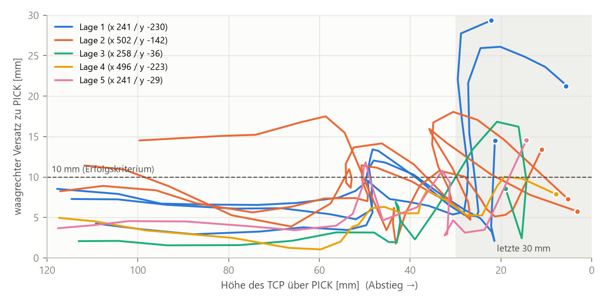
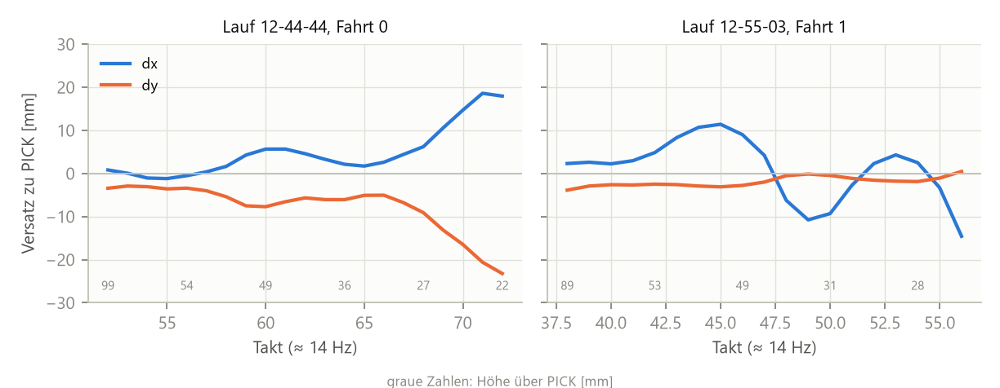
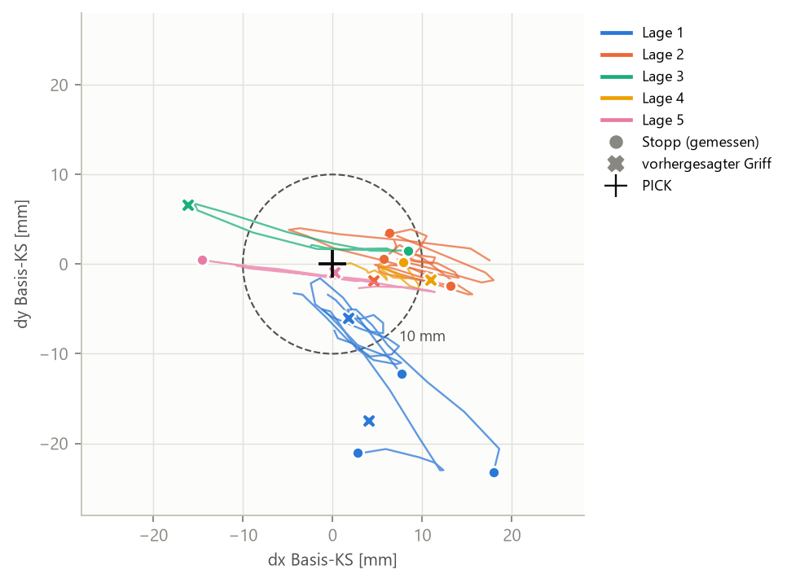

# Anlagentest Policy var_C2 – Probegriff mit bekannter Lage (2026-11-16)

**Verwendung offen:** *Teil der Versuchsreihe Policy-Varianten. Ob sie in den finalen Bericht kommt oder für
eine andere Arbeit aufgehoben wird, ist noch nicht entschieden (Anwender, 2026-11-13).*

**Datum:** 2026-11-16, 11:35–12:56, reale Anlage (`in_simulation` = False)

**Checkpoint:** `checkpoints/var_C2/policy` (Datensatz `datasets/var_C2`, 602 Episoden, 10 000 Schritte)

**Ausführung:** `servo_j`, 60 Hz, Override 0,5, Policy asynchron (Vorhersage ~73 ms, ≈ 14 Takte/s),
`replan 2`, `decay 0`, Kameras Daheng wrist + scene je 60 fps.

**Ablauf (Commit c1fc05f „Test Policy“):** `infer.py --lage-bekannt --probegriff objekt`. PICK und Tisch kommen live
aus der Steuerung (Touch-up). Die Policy fährt selbst an. Sie wird angehalten, bevor die Backenspitzen 3 mm über
der Objektoberkante sind. Aus dem Rest des Chunks wird bestimmt, wo sie gegriffen hätte. Danach korrigiert der
Planer (Experte) auf Stopphöhe in xy und Drehung auf PICK, senkt senkrecht ab, greift, legt an einer neuen Lage ab
und führt PICK nach.

Rohdaten: `checkpoints/var_C2/policy/rollouts/2026-11-16_*`. Auswertung `skripte/auswertung.py`, Tabellen
`abbildungen/fahrten.csv`, `abbildungen/hoehe.csv`.

---

## Läufe

| Lauf | Fahrt | Lage (PICK x / y mm, Drehung) | Probegriff | Stopp | Stopp: Höhe über PICK | Stopp: xy | vorhergesagter Griff xy | Drehfehler | Korrektur Experte | Erfolg laut Auswertung |
|---|---:|---|---|---|---:|---:|---:|---:|---:|---|
| 11-35-28 | – | – | – | Ordner leer, Lauf abgebrochen | – | – | – | – | – | – |
| 11-37-51 | 0 | – (ohne bekannte Lage) | – | **Not-Aus Handbediengerät** (Takt ~86), Log: max_steps | – | – | – | – | – | nein |
| 12-41-26 | – | – | – | nur Kameraprüfung | – | – | – | – | – | – |
| 12-42-28 | 0 | 1: 241 / −230, 111° | **tisch** (echter Griff) | **Not-Aus Handbediengerät** (Takt ~78), Log: max_steps | 5,7 mm | 21,2 mm | – | −3,0° | – | nein |
| 12-44-44 | 0 | 1: 241 / −230, 111° | objekt | kollision vorab | 22,1 mm | 29,4 mm | 18,0 mm | +1,0° | (nicht aktiv) | nein |
| 12-45-48 | 0 | 1: 241 / −230, 111° | objekt | kollision vorab | 21,3 mm | 14,5 mm | 6,3 mm | +11,8° | (nicht aktiv) | ja |
| 12-50-59 | 0 | 2: 502 / −142, 121° | objekt | **Violation Tischebene** | 5,2 mm | 7,3 mm | – | +8,3° | – | nein (*) |
| 12-52-08 | 0 | 2: 502 / −142, 121° | objekt | **Violation Tischebene** | 3,2 mm | 5,8 mm | – | +8,7° | – | nein (*) |
| 12-53-36 | 0 | 2: 502 / −142, 121° | objekt | kollision vorab | 11,0 mm | 13,4 mm | 5,0 mm | +0,8° | 12,4 mm, −3,0° | ja |
| 12-53-36 | 1 | 3: 258 / −36, 132° | objekt | kollision vorab | 19,0 mm | 8,6 mm | 17,4 mm | −5,3° | 8,5 mm, +2,7° | nein |
| 12-55-03 | 0 | 4: 496 / −223, 114° | objekt | kollision vorab | 7,8 mm | 7,9 mm | 11,1 mm | +2,5° | 8,3 mm, −3,8° | nein |
| 12-55-03 | 1 | 5: 241 / −29, 128° | objekt | kollision vorab | 14,4 mm | 14,6 mm | 1,0 mm | +0,1° | 13,9 mm, −2,6° | ja |

(*) siehe „Auffälligkeiten im Ablauf“: Der Stopp war derselbe Probegriff-Stopp, wurde aber nicht als solcher erkannt.

**Not-Aus:** Der Anwender hat 2–3-mal am Handbediengerät der Anlage den Not-Aus gedrückt, weil der Arm abzutauchen
schien. In 11-37-51 und 12-42-28 ist das in den Daten zu sehen: Der gemessene Arm steht ab Takt ~78–86 still, die
Ziele der Policy laufen weiter. `infer.py` hat den Not-Aus nicht bemerkt und bis `max_steps` weiter Ziele gesendet
(Abstand Ziel – Messung am Ende bis 0,26 rad). Ob in 12-50-59 / 12-52-08 zusätzlich gedrückt wurde, lässt sich aus
den Daten nicht trennen. Dort hat in jedem Fall der Geofence-Wächter mit gemessenem Eindringen ausgelöst.

**Zusammenfassung:** 9 Fahrten mit bekannter Lage an 5 Lagen, davon 8 Probegriffe „objekt“ und 1 echter Griff.
Vorhergesagter Greifpunkt (6 Fahrten): Median **8,7 mm**, Spanne 1,0–18,0 mm, 3 von 6 ≤ 10 mm. Mit den beiden
Violation-Fahrten (Stopp 3–5 mm über PICK, 5,8 / 7,3 mm daneben) liegen **5 von 8** Probegriffen innerhalb 10 mm.
Drehfehler meist unter 5°, Lage 1 und 2 zeitweise 8–16°. Der Wert passt zum VM-Replay vom 13.11. (nächste
Annäherung Median 10,7 mm).

---

## Ergebnis 1: Der Versatz entsteht unterhalb von PRE_PICK, wenn die Policy zögert

*Abb. 1: Waagrechter Abstand des gemessenen TCP zu PICK über der Höhe, je Fahrt (Farbe = Lage, Punkt = Stopp).*

| Höhe über PICK | 100 mm | 60 mm | 40 mm | 30 mm | 20 mm |
|---|---:|---:|---:|---:|---:|
| xy-Versatz median | 6,6 mm | 5,4 mm | 9,0 mm | 5,7 mm | 14,6 mm |
| Spanne | 1,6–14,5 | 1,1–17,5 | 2,3–11,6 | 3,1–17,1 | 5,3–24,9 |
| Fahrten | 9 | 9 | 9 | 9 | 7 (2 vorher gestoppt) |

Bis PRE_PICK (50 mm über PICK) folgt die Policy der senkrechten Idealbahn meist auf 1–7 mm genau. Darunter
erreicht der seitliche Versatz in jeder Fahrt 10–29 mm, oft innerhalb weniger Takte. Die Ausschläge treten dort auf,
wo die Policy **zögert**: Ab 60 mm Höhe sind ein Drittel bis die Hälfte aller Takte „stehend“ (33–53 %,
Höhenänderung < 2 mm je Takt; ohne 12-42-28, dort steht der Arm nach dem Not-Aus). Typisch ist ein Halt bei
~50 mm (PRE_PICK, in der Aufnahme mit 10 mm überschliffen) und ein zweiter bei 27–32 mm, teils mit kurzem
Wiederanheben. In diesen Halten wandert der TCP seitlich hin und her (Abb. 2).

*Abb. 2: dx/dy zu PICK über den Takten in zwei Fahrten. Links ein gleichsinniges Wegdriften im zweiten Halt
(Lage 1), rechts ein Pendeln in x um ±11 mm zwischen 50 und 28 mm Höhe (Lage 5). Dort hätte der Rest des Chunks
dennoch 1 mm neben PICK gegriffen.*

Der Fehler ist also **kein fester Versatz**, sondern eine Unsicherheit im Zögern vor dem Griff. Das gleiche Muster
zeigte sich schon in der VM: Stillstand und Greifer-Pause sind im Zustand nicht von „losfahren“ zu unterscheiden.

## Ergebnis 2: Richtung je Lage

*Abb. 3: Bahn der letzten 60 mm in Koordinaten relativ zu PICK (Basis-KS), Stopp (Punkt) und vorhergesagter Griff
(Kreuz).*

An Lage 1 (x 241 / y −230) lag die Policy in allen drei Fahrten in −y daneben (Stopp und Vorhersage −6 bis
−23 mm), an Lage 2 und 4 (x ≈ 500) in +x (+5 bis +13 mm). An Lage 3 und 5 (x ≈ 250 / y ≈ −30) springt sie in beide Richtungen.
Bei 5 Lagen ist das ein Hinweis auf einen lageabhängigen Anteil, aber kein belastbarer systematischer Fehler.

## Ergebnis 3: Greifen wurde nicht erreicht – Schließen bleibt ungeprüft

- Keiner der 6 Chunks zum Zeitpunkt des Stopps enthält ein Schließen (`vorhersage_schliesst` = False). Die Stopps
  lagen aber 8–22 mm über PICK, und vom Chunk ist nur noch ein kurzer Rest (5–7 Ziele) vorhanden. Dass dort noch
  kein Schließen steht, ist kein belastbarer Befund.
- Beim einzigen echten Griff (12-42-28, Probegriff „tisch“) erreichte der TCP in Takt 76 5,1 mm über PICK, aber
  **21 mm seitlich daneben**. Die Backen standen damit unterhalb der Objektoberkante neben dem Teil. Hier löste der
  Anwender den Not-Aus aus, der Arm stand ab Takt ~78. Der „Stillstand bis max_steps“ ist also der Not-Aus, kein
  Zögern der Policy.

Ob die Policy an der richtigen Stelle schließen würde, ist damit an der Anlage noch nicht geprüft. Die Not-Aus-Fahrt
zeigt aber, dass ein echter Griff mit dem heutigen Versatz ohne Korrektur zur Berührung mit dem Teil führen kann.

## Ergebnis 4: Korrekturen durch den Experten

4 Korrekturen (12-53-36 und 12-55-03, je 2 Fahrten), alle erfolgreich gegriffen und neu abgelegt, PICK nachgeführt.
Korrektur 8,3–13,9 mm, fast nur in x (dy ≤ 2,1 mm), Drehung ±2,6–3,8°, Abstieg 8,9–18,9 mm, Dauer 11–13 s.

Die Korrektur misst den **Moment des Stopps mitten im Ausschlag**, nicht den Fehler, mit dem die Policy gegriffen
hätte. Beispiel 12-55-03 Fahrt 1: Korrektur 13,9 mm, vorhergesagter Griff 1,0 mm. Umgekehrt 12-53-36 Fahrt 1:
Korrektur 8,5 mm, vorhergesagter Griff 17,4 mm.

---

## Auffälligkeiten im Ablauf

1. **Violation-Stopp wird nicht als Teststopp erkannt.** In 12-50-59 und 12-52-08 hielt die Sicherung mit
   `stopp: [Violation(… Frame 'tool', Quader 'Tischebene', Freiraum −3,1 / −3,9 mm …)]` statt mit „kollision vorab“.
   `expected_test_stop` (`apps/infer.py`, Zeile 591) erkennt nur „kollision vorab … Tischebene“. Folge: kein Experte,
   „Arbeitsraum prüfen“, Erfolg = nein. Dabei sind das die beiden Fahrten, die am tiefsten und am genauesten
   angekommen sind (3–5 mm über PICK, 6–7 mm daneben).
2. **Stopphöhe streut stark** (3–22 mm über PICK), weil „kollision vorab“ das nächste Ziel des Chunks prüft und die
   Policy im Ausschlag teils in großen Schritten absenkt.
3. Für 12-44-44 und 12-45-48 war der Experte noch nicht eingeschaltet („stehen geblieben – Spiel prüfen“).
4. In den Fahrt-Logs (`rollout_*.npz`, `experte_*.npz`) sind **keine Kamerabilder** gespeichert, nur Gelenke, TCP,
   Aktionen und Greifer.
5. **Not-Aus am Handbediengerät wird nicht erkannt.** `infer.py` sendet weiter Ziele, während der Arm steht. Die
   Lücke zwischen Ziel und Messung wächst auf bis zu 0,26 rad. Der Lauf endet als `max_steps`, ohne Hinweis auf den
   Not-Aus. Nötig ist eine Prüfung „Arm folgt nicht“ (Messung steht, Ziel läuft weg), die die Fahrt beendet und den
   Stopp im Log vermerkt. Dann springt der Arm nach dem Entriegeln auch nicht auf ein altes Ziel.
6. Der Stopp-Knopf der GUI beendet den Prozess sofort, dann fehlen `summary.json` und CSV (vermutlich 11-35-28).
   Manuelle Stopps sollten mit Grund im Lauf landen.

---

## Bewertung: Lässt sich der Versatz mit DAgger verringern?

**Grundsätzlich ja.** Die Fehler entstehen in Zuständen, die in den Demos fehlen: Die Policy zögert nah über dem
Objekt und ist schon seitlich daneben, die Demos dagegen fahren senkrecht ab. Genau diese Zustände sammelt DAgger
und beschriftet sie mit der Aktion des Experten.

In der heutigen Form reicht es aber noch nicht:

1. **Bilder mitschreiben.** Ohne Kamerabilder der Zustände, in die die Policy fährt, lässt sich nicht trainieren.
   Die Policy-Fahrt und die Korrektur des Experten sollten als LeRobot-Episode wie bei der Aufnahme gespeichert werden.
2. **Jeden Takt beschriften, nicht nur den Stopp.** Mit der bekannten PICK-Pose lässt sich jeder Takt der letzten
   ~60 mm nachträglich mit der Planer-Aktion „von hier senkrecht über PICK, dann ab“ beschriften. Das deckt die
   Halte bei 50 und 30 mm ab, in denen der Fehler entsteht, und kostet keine Fahrzeit.
3. **Mehr Korrekturen und höher gewichten.** Heute sind es 4 gegenüber 602 Demo-Episoden. Für eine messbare Wirkung
   eher 50–100 Korrekturfahrten, beim Training höher gewichtet (Oversampling).
4. **Schließen mit beschriften.** Die Korrektur sollte auch das Schließen des Greifers als Label enthalten. Ob die
   Policy selbst richtig schließt, ist an der Anlage noch ungeprüft (Ergebnis 3).
5. **Lage über M1/M2 statt Touch-up** (Idee Anwender, 16.11.): Objekt frei hinlegen, M1 oder M2 bestimmt die Pose
   mit Orientierung, Policy fährt, bei Versatz korrigiert der Planer auf diese Pose. So kommen schnell viele
   verschiedene Lagen zusammen, und die Korrektur ist unabhängig vom manuell geteachten PICK.

**Vor der nächsten Anlagenfahrt:** Not-Aus erkennen und Fahrt beenden (Punkt 5), Violation-Stopp an der
Tischebene als Teststopp zählen (Punkt 1), Bilder mitschreiben, PICK-Quelle austauschbar machen (Steuerung/Touch-up
oder M1/M2).

---

## Dateien

- `skripte/auswertung.py <rollouts> abbildungen` – Tabellen und Abbildungen
- `skripte/md_zu_pdf.py Testprotokoll.md ../2026-11-16_Anlagentest_var_C2.pdf` – dieses PDF
- `abbildungen/fahrten.csv` – je Fahrt Stopp, Vorhersage, Korrektur; `abbildungen/hoehe.csv` – Versatz je Höhe
