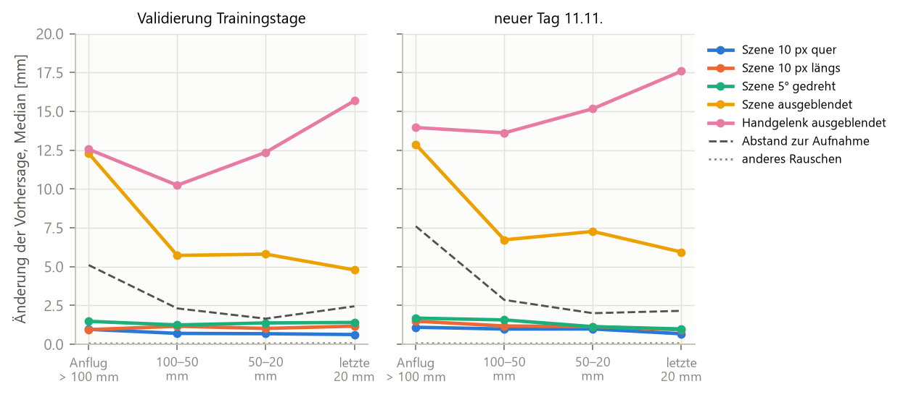

# Kameraempfindlichkeit var_C2 – lohnt die ArUco-Rektifizierung? (2026-11-16)

**Verwendung offen:** *Teil der Versuchsreihe Policy-Varianten. Ob sie in den finalen Bericht kommt oder für
eine andere Arbeit aufgehoben wird, ist noch nicht entschieden (Anwender, 2026-11-13).*

**Frage (Anwender):** Die Policy macht nur noch den Griff, nicht mehr den Weg zur Teststation. Würde die
ArUco-Rektifizierung der Szenenkamera (`bc/rectify.py`) helfen, vor allem gegen Kameraschwankungen?

**Vorgehen:** Offline, ohne Roboter (`skripte/empfindlichkeit.py`, RTX 5070 Ti, ~10 min). Für jeden zweiten
Takt bis zum Griff geht die Beobachtung einer Aufnahme (2 Takte Historie, beide Kameras, Zustand) in var_C2.
Die Vorhersage läuft einmal ungestört und einmal mit gestörtem Bild, beide Male mit **demselben**
Diffusionsrauschen. Verglichen wird die waagrechte TCP-Lage am Ende der ausgeführten Aktionen (Chunk-Index 7,
TCP per URDF-Vorwärtskinematik).

- **Episoden:** 15 Validierungsepisoden der Trainingstage (02./03./09.11., nicht trainiert) und 15 Episoden vom
  **11.11.**, einem Tag, der gar nicht im Training war (eigene Kameralage, eigenes Licht). Zusammen 1170 Takte.
- **Störungen** (immer auf beide Historienbilder, wie eine bewegte Kamera):
  - Szene 10 px quer / 10 px längs – das ist die Spanne, um die die Szenenkamera zwischen den Trainingstagen lag
    (8–10 px). Im 320×240-Bild ist 1 px etwa 3 mm auf dem Tisch (Markerkante 66–79 px im Vollbild bei 5-cm-Markern).
    10 px wirken also wie ein um **~3 cm verschobenes Teil**.
  - Szene 5° gedreht (zwischen den Trainingstagen waren es 3–6°).
  - Szene ausgeblendet / Handgelenk ausgeblendet (Bild durch seine mittlere Farbe ersetzt).
- **Bezug:** dieselbe Beobachtung mit anderem Rauschen (Streuung der Policy selbst) und der Abstand der
  Vorhersage zur Aufnahme.
- **Phasen** nach der Höhe des TCP über dem Greifpunkt der Aufnahme.

---

## Ergebnis

*Abb. 1: Änderung der Vorhersage (Median, mm) je Phase und Störung.*

Median (p90) der waagrechten Änderung in mm:

| Herkunft | Phase | Takte | Szene 10 px quer | Szene 10 px längs | Szene 5° gedreht | Szene ausgeblendet | Handgelenk ausgeblendet | anderes Rauschen | Abstand zur Aufnahme |
|---|---|---:|---:|---:|---:|---:|---:|---:|---:|
| Validierung | Anflug > 100 mm | 397 | 1,0 (2,0) | 0,9 (2,0) | 1,5 (3,1) | 12,3 (21,0) | 12,6 (24,5) | 0,0 (0,1) | 5,1 (17,6) |
| Validierung | 100–50 mm | 51 | 0,7 (1,5) | 1,2 (1,6) | 1,2 (2,5) | 5,7 (8,2) | 10,2 (17,5) | 0,0 (0,1) | 2,3 (5,0) |
| Validierung | 50–20 mm | 77 | 0,7 (1,5) | 1,0 (1,8) | 1,4 (3,3) | 5,8 (8,8) | 12,4 (20,7) | 0,1 (0,1) | 1,6 (3,8) |
| Validierung | letzte 20 mm | 74 | 0,6 (1,3) | 1,2 (2,1) | 1,4 (3,2) | 4,8 (9,8) | 15,7 (22,6) | 0,1 (0,1) | 2,4 (5,2) |
| neuer Tag 11.11. | Anflug > 100 mm | 371 | 1,1 (2,3) | 1,5 (2,8) | 1,7 (4,3) | 12,9 (22,9) | 14,0 (26,9) | 0,1 (0,2) | 7,6 (25,1) |
| neuer Tag 11.11. | 100–50 mm | 48 | 1,0 (1,9) | 1,2 (2,7) | 1,6 (3,1) | 6,7 (11,7) | 13,6 (23,1) | 0,0 (0,1) | 2,9 (5,2) |
| neuer Tag 11.11. | 50–20 mm | 77 | 1,0 (1,9) | 1,1 (3,1) | 1,1 (2,9) | 7,3 (12,1) | 15,2 (23,7) | 0,1 (0,1) | 2,0 (3,5) |
| neuer Tag 11.11. | letzte 20 mm | 75 | 0,7 (1,5) | 0,9 (1,9) | 1,0 (2,6) | 5,9 (11,3) | 17,6 (28,7) | 0,1 (0,1) | 2,2 (4,5) |

1. **Die Policy reagiert kaum auf die Lage der Szenenkamera.** Eine Verschiebung, die einem 3 cm versetzten Teil
   entspräche, ändert die Vorhersage nur um **0,6–1,5 mm** (p90 ≤ 3 mm), eine Drehung um 5° um 1,0–1,7 mm.
   Das sind etwa 3–5 % der Bildverschiebung. Eine naheliegende Erklärung ist das Training: Es schneidet zufällig
   90 % des Bildes aus (`crop_ratio 0.9`, ±12–16 px) und hat damit Verschiebungen schon gelernt zu ignorieren.
2. **Die Szenenkamera wird vor allem im Anflug gebraucht.** Ausgeblendet ändert sie die Vorhersage dort um
   12–13 mm, in den letzten 100 mm nur noch um 5–7 mm.
3. **Am Griff zählt die Handgelenkkamera.** Ausgeblendet ändert sie die Vorhersage um 10–18 mm, am stärksten in
   den letzten 20 mm (15,7 / 17,6 mm).
4. **Offline ist die Policy auch am neuen Tag genau.** In den letzten 20 mm liegt die Vorhersage im Median
   2,2–2,4 mm von der Aufnahme entfernt. Der Tag 11.11. ist kaum schlechter als die Validierung der Trainingstage.
   An der Anlage waren es heute im Median 8,7 mm (Bericht `2026-11-16_Anlagentest_var_C2`). Der Unterschied
   entsteht also im geschlossenen Kreis: in Zuständen, die die Policy selbst herbeiführt (Zögern, seitliches
   Abdriften), und nicht durch ein anders aussehendes Kamerabild.
5. Die Policy streut von sich aus kaum (anderes Rauschen: ≤ 0,2 mm). Die gemessenen Änderungen sind also echte
   Reaktionen auf das Bild.

## Bewertung

Für var_C2 lohnt die Rektifizierung **nicht**. Sie würde genau das ausgleichen, worauf die Policy schon heute
fast nicht reagiert, nämlich die Lage der Szenenkamera. Dagegen stünden Aufwand und Risiken: starke
Objektivverzerrung, für die vorher eine Kamerakalibrierung nötig wäre, schief abgebildete Teile über der
Tischebene (vor allem der Arm) und unsichere Markererkennung bei 240×320. Neu aufnehmen müsste man nicht, die
Vollbilder je Block liegen in `data/<Datum>/referenzbilder/`. Der Aufwand stünde aber in keinem Verhältnis.

Mehr bringen dürfte:

- **Stabile Handgelenkkamera.** Sie dominiert am Griff. Halterung, Belichtung und Licht am Greifer sollten von
  Tag zu Tag gleich sein (Kameraprüfung vor der Fahrt beibehalten).
- **Drehung als Augmentierung** im Training (±5°) statt Rektifizierung, falls die Szenenkamera einmal stärker
  verdreht ist. Das braucht keine neuen Daten.
- **DAgger für den letzten Abstieg** (siehe Anlagentest): Der Fehler an der Anlage stammt aus dem geschlossenen
  Kreis, nicht aus dem Kamerabild.

**Grenzen:** Die Verschiebung ist synthetisch. Eine echt bewegte Kamera ändert auch die Perspektive, besonders
beim Arm. Die Lage der Handgelenkkamera wurde nicht verschoben, sie ist am Greifer fest montiert. Die Messung
zeigt, wie sich die **Vorhersage ändert**, nicht, ob eine Fahrt gelingt.

---

## Dateien

- `skripte/empfindlichkeit.py <ausgabe>` – Vorhersagen mit Störungen (`daten/takte.json`, je Takt alle Werte)
- `skripte/auswertung.py daten abbildungen` – Tabelle (`abbildungen/tabelle.md`) und Abbildung
- `skripte/md_zu_pdf.py Testprotokoll.md ../2026-11-16_Kameraempfindlichkeit_var_C2.pdf` – dieses PDF
