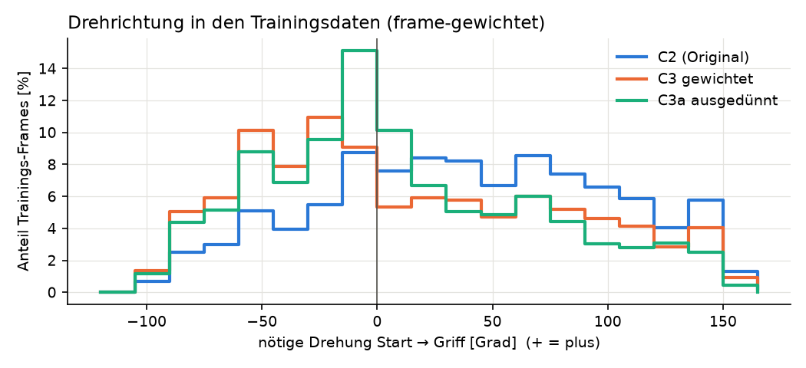
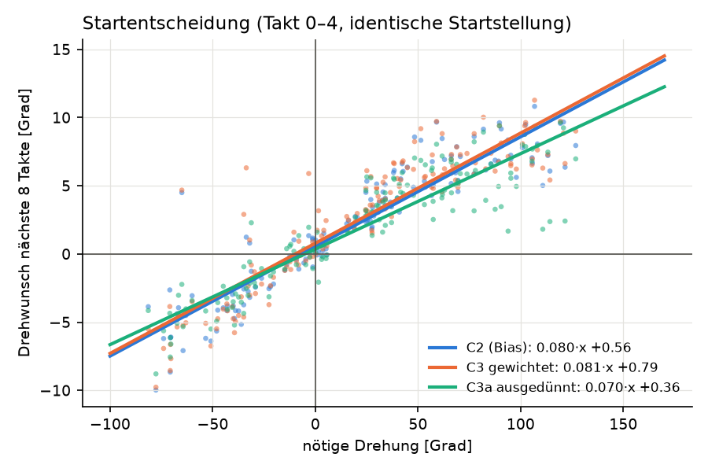
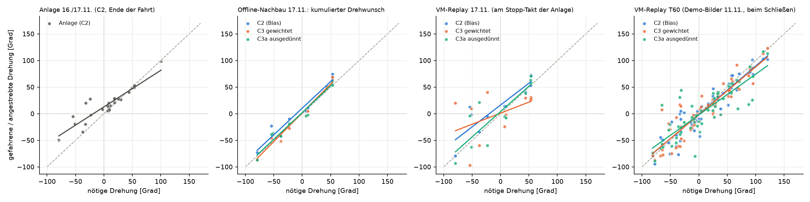

# Drehbias der Demos – Vergleich C2 / C3 (gewichtet) / C3a (ausgedünnt) (2026-11-17)

**Anlass:** Beim Anlagentest am 16./17.11. dreht C2 Minus-Lagen deutlich zu wenig, Plus-Lagen gehen. Vermutung: In den
Demos muss viel öfter nach plus als nach minus gedreht werden. Der Betreuer schlug vor, plus und minus unterschiedlich zu
gewichten oder die Plus-Fahrten herauszunehmen. Gefragt ist, welche Variante besser wirkt und welche vergleichbarer ist,
außerdem wie gut VM und Nachbau das Anlagenverhalten vorhersagen.

**Ordner (seit 17.11. umbenannt, `tools/checkpoints_umbenennen.py`):**

| bisher | jetzt | Inhalt |
|---|---|---|
| var_C2 | `checkpoints/C2_nur_griff_ohne_1111` | Datensatz `var_C2` (02./03./09.11., Episode endet 3 Takte nach dem Schließen), Anlagenmodell |
| var_C3 | `checkpoints/C3_wie_C2_drehung_gewichtet` | gleiche Daten, MINUS-Episoden 2,83-fach gezogen |
| var_C3a | `checkpoints/C3a_wie_C2_plus_ausgeduennt` | gleiche Daten, 238 von 373 PLUS-Episoden nie gezogen |

Auch A, B, C, D und F tragen jetzt sprechende Namen: `A_basis`, `B_pause_kurz`, `C_nur_griff`, `D_eine_drehung`,
`F_licht_augment`. Pfade in Skripten, Doku und `summary.json` sind angepasst. Im Fließtext älterer Protokolle stehen weiter
die alten Namen.

Skripte: `skripte/` (Ketten, Nachbau, Auswertung), Zahlen: `daten/zusammenfassung.json`, Logs: `logs/`.

---

## 1. Der Bias in den Daten

Drehung = Richtung der Werkzeug-x-Achse um die Senkrechte, Start → erster geschlossener Greifer, volle 360°
(`tools/analyse_drehung.py`). „klein“ = |Drehung| < 10°.

| | Episoden | Frame-Anteil | Mittel |
|---|---:|---:|---:|
| plus | 373 (62 %) | 65 % | |
| klein | 78 (13 %) | 12 % | |
| minus | 151 (25 %) | 23 % | |
| gesamt | 602 | | **+38,8°** |

Spanne −120° … +180°, große Plus-Drehungen (> 90°) deutlich häufiger als große Minus-Drehungen. Der Ort der Lage
hängt nicht mit der Richtung zusammen (Korrelation Drehung–x/y < 0,05). Der Bias liegt also nur in der Drehung.

**Anlage C2 (27 Fahrten 16./17.11.):** Minus-Lagen median **31°** zu wenig gedreht (n = 8), Plus-Lagen median 3°
daneben (n = 12), 2 Fahrten falsch herum. Gedreht ≈ 0,69 × nötig + 12,8°.

## 2. Vorgehen: C3 und C3a

Kein neuer Export. Datensatz, Episoden, Train/Val-Split, Normierung, Seed 0, 10 000 Schritte und Batch 128 sind
**identisch mit C2**. Nur die Ziehwahrscheinlichkeit der Episoden im Training ändert sich
(`apps/train.py --episoden-gewichte`, Gewichte aus `tools/drehung_ausgleich.py`, abgelegt in
`gewichte_C3_*.json`). Ausgeglichen wird die **Frame-Masse**, denn Plus-Episoden sind länger. Bei gleicher Episodenzahl
blieben noch ~50/40 % der Frames.

| | Regel | plus / klein / minus (Frames) | Mittel |
|---|---|---|---:|
| C2 | – | 65 / 12 / 23 % | +38,8° |
| **C3 gewichtet** | MINUS × 2,834 | 46 / 8 / 46 % | +14,0° |
| **C3a ausgedünnt** | 238 von 373 PLUS auf 0 (Seed 0) | 40 / 21 / 40 % | +9,8° |

Validierung auf denselben, ungewichteten Val-Episoden:

| | Val-Loss | Gelenk-MAE | p95 | Greifer |
|---|---:|---:|---:|---:|
| C2 | 0,0112 | 0,0081 rad | 0,0308 | 97,6 % |
| C3 | 0,0110 | **0,0080** | 0,0305 | 97,6 % |
| C3a | 0,0112 | 0,0098 | 0,0388 | 97,6 % |

C3 verliert nichts an Genauigkeit. C3a ist messbar ungenauer, das ist der Preis für 40 % weniger Plus-Daten. Für den
Vergleich ist **C3 die sauberere Variante**: Es ändert sich genau eine Größe. C3a ändert Richtungsanteil und
Datenmenge zugleich, wie damals Variante D.

## 3. Offline-Nachbau der Anlagenfahrten vom 17.11.

Die 11 DAgger-Episoden (`data/2026-11-17_dagger`) enthalten Bilder und Zustand der C2-Fahrten an der Anlage. Jedes
Modell bekommt genau diese Beobachtungen und sagt alle 2 Takte einen Chunk vorher (`skripte/nachstellen_offline.py`).

**Treue:** C2 offline gegen die an der Anlage protokollierten Vorhersagen: |Diff| median **0,01°**, p95 0,04°
(n = 347). Der Nachbau trifft also exakt, was C2 an der Anlage entschieden hat.

**Grenze:** Der Nachbau ist offen. Jedes Modell sieht immer die C2-Bahn. Was C3 anders gedreht hätte, wirkt nicht auf
seine nächsten Bilder zurück. Das Ziel am Ende der Fahrt ist deshalb bei allen drei Modellen fast gleich (dort steht
jedes in der C2-Stellung) und taugt nicht zum Vergleich. Verglichen wird der **kumulierte Drehwunsch**: die Summe der
Wünsche (je 8 Takte, alle 2 Takte neu) / 4, also die Drehung, die das Modell offen gefahren hätte.

| Ep. | nötig | Anlage (C2) | C2 | **C3** | C3a |
|---:|---:|---:|---:|---:|---:|
| 2 | −51 | −19 | −37 | −38 | −37 |
| 6 | −54 | −5 | −23 | **−46** | −38 |
| 8 | −38 | −34 | −42 | −52 | −42 |
| 9 | −23 | −2 | −10 | **−27** | −19 |
| 10 | −79 | −50 | −73 | **−88** | −87 |
| 3 | +53 | +49 | +68 | +64 | +61 |
| 4 | +53 | +51 | +63 | +60 | +62 |
| 5 | +53 | +53 | +75 | +69 | +54 |
| 7 | +44 | +41 | +50 | +47 | +50 |

Unterschied zu C2: **C3 bei minus median −15°** (−1 … −22), bei plus −4°. **C3a bei minus −9°**, bei plus −4°,
dazu ein Ausreißer (Ep. 5: −21°). Die Summe überschätzt die gefahrene Drehung (C2: Summe ≈ 1,3 × Anlage), denn der Arm
folgt nicht vollständig (Abschnitt 5). Für den Abstand zwischen den Modellen spielt das keine Rolle.

## 4. Frühentscheidung auf 151 Demos vom 11.11. (in keinem Training)

Mittlerer Drehwunsch der ersten 3 Vorhersagen (Arm steht noch), Demo-Bilder:

| | Wunsch = k × nötig + d | minus median | richtig | plus median | richtig |
|---|---|---:|---:|---:|---:|
| C2 | 0,080 × + 0,56 | −3,8° | 91 % | +5,8° | 100 % |
| C3 | 0,081 × + 0,79 | −3,9° | 89 % | +6,1° | 100 % |
| C3a | 0,070 × + 0,36 | −3,2° | 89 % | +4,6° | 100 % |

Mit Demo-Bildern entscheiden alle drei fast gleich. Über die ganze Anfangsphase (bis die Demo 10° gedreht hat) ist
**schon C2 symmetrisch**: Bei Minus- wie Plus-Lagen hat es dort ~43 % der nötigen Drehung vor. Der Bias zeigt sich also
nicht in der Entscheidung, solange die Bilder aus Demos stammen. Er entsteht erst in der Fahrt an der Anlage.

## 5. Wo die Drehung verloren geht

**a) Die Drehung passiert nur bis ANFLUG.** Im Ablauf `pick_to_station` haben ANFLUG (15 cm über PICK), PRE_PICK (5 cm)
und PICK dieselbe Orientierung. Die ganze Drehung steckt in der PTP-Fahrt `CLEAR_FOV → ANFLUG`.

| Anteil der nötigen Drehung bei … | 15 cm (ANFLUG) | 5 cm (PRE_PICK) | 1 cm |
|---|---:|---:|---:|
| Demos plus (87) | 99 % | 100 % | 100 % |
| Demos minus (29) | 99 % | 100 % | 100 % |
| Anlage plus (4) | 85 % | 97 % | 98 % |
| Anlage minus (5) | **30 %** | 37 % | 37 % |

Unter ANFLUG hat die Policy nie eine Drehung gesehen. Was bis dahin fehlt, holt sie kaum nach: Ep. 6 hatte bei ANFLUG
−12° (nötig −54°), am Griff −6°.

**b) Der Arm folgt schlechter als in den Demos** (`skripte/ausfuehrung.py`: Gierwinkel gemessen gegen Kommando 2 Takte
vorher):

| | mittlere Abweichung | größte Abweichung (p90 der Fahrten) | Kommandoschritt p95 |
|---|---:|---:|---:|
| Demos | 0,9° | 6,3° | 1,8°/Takt |
| Anlage C2 | 2,2° | 13,0° | 2,4°/Takt |
| VM T60 C2 | 2,6° | 11,5° | 2,5°/Takt |

Die Policy kommandiert ~35 % größere Schritte als die Demos, der Arm hinkt hinterher. In der VM ist das genauso, an der
Mechanik der Anlage liegt es also nicht. Jeder neue Chunk startet von der gemessenen Stellung. Verlorene Drehung wird
nicht gezielt nachgeholt. In Ep. 6 drehte der Arm um Takt 12–20 auf +8°, obwohl alle Kommandos nach minus zeigten.
Ob die Fahrt selbst eine Drehung nach plus erzeugt, lässt sich aus diesen Daten nicht sicher trennen.

## 6. VM-Replay

### 6a. Heutige Fahrten (Bilder der C2-Anlagenfahrten)

`stufe2_vm.py --transport-geplant`, 11 DAgger-Episoden, C2 zweimal.

| | Lage-Abstand zur Anlagenbahn (median) | ServoGuard-Stopps | Tisch-Violation |
|---|---:|---:|---:|
| C2 | 10 mm | 3 | 0 |
| C2 Wiederholung | 9 mm | 2 | 1 |
| C3 | 23 mm | 2 | 1 |
| C3a | 51 mm | 5 | 1 |

- **C2 gegen Anlage:** Drehung am Stopp-Takt median 6° daneben, max 30° (Ep. 6: VM +13°, Anlage −5°).
  **C2 gegen C2-Wiederholung:** median 4°, max 16°. Die VM streut also schon mit demselben Modell in der Größenordnung
  des gesuchten Effekts.
- **C3 / C3a laufen auseinander:** Bahnabstand bis 170 mm, Drehung teils völlig daneben (C3 Ep. 6 −97°, Ep. 9 +40°).
  Grund: Die Gelenkstellung folgt dem neuen Modell, die Bilder bleiben die der C2-Fahrt. Sobald ein Modell anders fährt
  als C2, widersprechen sich Bild und Zustand. **Für C3/C3a ist dieser Test nicht auswertbar.**

### 6b. Testlagen T60 (Demo-Bilder 11.11., 59 Fahrten)

| | minus: Fehler (abs) | falsch herum | plus: Fehler (abs) | gedreht = k × nötig + d | nächste Annäherung | ≤ 10 mm | p90 | Greif-xy | unter Tisch | ServoGuard | Endstellung |
|---|---|---:|---|---|---:|---:|---:|---:|---:|---:|---:|
| C2 | +1,9 (16,8) | 0 | −2,4 (9,4) | 0,91 × −1,3 | 15,5 mm | 32 % | 45 mm | 18,7 mm | 47 % | 7 % | 90 % |
| C3 | −10,5 (18,6) | 2 | −6,8 (8,6) | 0,90 × −1,8 | 15,5 mm | 33 % | 52 mm | 20,9 mm | 47 % | 7 % | 90 % |
| C3a | +5,7 (10,8) | **4** | −4,9 (6,9) | 0,77 × −2,2 | **24,2 mm** | **15 %** | 46 mm | **34,3 mm** | 54 % | 3 % | 92 % |

C3a: Die VM-Verbindung brach am 17.11. um 21:12 nach 37 Fahrten ab. Die übrigen 22 Fahrten wurden um 22:13–22:20
nachgeholt (`vm_T60_rest`) und zusammengeführt (`skripte/kette_C3a_rest.sh`).

- In T60 dreht schon C2 nahezu richtig (Steigung 0,91, an der Anlage 0,69). Die Demo-Bilder führen die Drehung, der Bias
  bleibt verborgen.
- C3 verschiebt hier alles Richtung minus (minus jetzt 10° zu viel, plus 7° zu wenig). Das ist dieselbe Richtung wie im
  Nachbau. Hier ist es zu viel, weil die Bilder ohnehin richtig führen.
- Bei C3 sind Genauigkeit und Sicherheit praktisch unverändert (Annäherung, Tisch, ServoGuard, Endstellung gleich,
  p90 und Greif-xy 2–7 mm schlechter).
- **C3a verliert deutlich an Genauigkeit:** nächste Annäherung 24 statt 15,5 mm, nur 15 % statt 32 % ≤ 10 mm,
  Greif-xy 34 statt 19 mm, öfter unter Tisch (54 %). Bei der Drehung ist der Betrag kleiner als bei C2, aber 4 Fahrten
  drehen falsch herum und die Steigung fällt auf 0,77. Weniger Daten schaden hier mehr, als der Ausgleich nützt.

## 7. Wie gut sagen die Tests die Anlage vorher?

| Test | Rückkopplung | Was er zeigt | Bewertung |
|---|---|---|---|
| Offline-Nachbau (Anlagenbilder) | keine | exakt, was das Modell **an derselben Stelle** will | treu (0,01°), aber offen: Effekt nur als Richtung/Größenordnung |
| Frühentscheidung (Demos 11.11.) | keine | Startentscheidung | zeigt den Anlagen-Bias **nicht** |
| VM heute (Anlagenbilder) | nur Zustand | C2 ≈ Anlage ± 6° (max 30°), Streuung ±4° | für andere Modelle **unbrauchbar** (Bild/Zustand widersprechen sich) |
| VM T60 (Demo-Bilder) | nur Zustand | Genauigkeit, Tisch, ServoGuard | Drehbias von C2 **nicht sichtbar** (0,91 statt 0,69) |
| Anlage | voll | – | einziger echter Test |

Keiner der Tests koppelt die Bilder zurück. Deshalb kann keiner eine Erfolgsquote für die Drehung vorhersagen. Der
Offline-Nachbau ist der verlässlichste Hinweis auf die Wirkung: Er zeigt, was das Modell in genau der Lage will, in
der C2 an der Anlage gescheitert ist.

## 8. Fazit

1. **Gewichten (C3) ist besser und vergleichbarer als Ausdünnen (C3a).** C3 will bei Minus-Lagen in den
   Anlagensituationen im Median 15° mehr nach minus drehen, C3a nur 9°. C3a verliert zudem Genauigkeit, weil Daten
   wegfallen: Gelenk-MAE +20 %, in T60 nächste Annäherung 24 statt 15,5 mm und 4 Fahrten falsch herum.
2. **Der Bias ist nur ein Teil der Ursache.** Selbst C3 käme z. B. bei −54° offen auf ~−46°, gefahren eher ~−35°.
   Die zweite Ursache ist die Fahrt: Die Drehung muss bis ANFLUG fertig sein. Der Arm folgt den (zu großen) Schritten
   der Policy schlecht. Unter ANFLUG wird nichts nachgeholt, weil die Demos dort nie drehen.
3. **Für die Anlage:** C3 ist ein sinnvoller Kandidat für einen Gegenversuch an denselben Minus-Lagen. Erwartet wird
   eine Verbesserung, keine Lösung. Genauigkeit und Sicherheit bleiben laut T60 gleich.

## 9. Folgerungen für den neuen Datensatz

- **Plus/minus ausgleichen** (wirkt, siehe C3). Am besten über die Lagenwahl beim Aufnehmen statt nachträglich, damit
  keine Daten verloren gehen. Ziel etwa gleich viel Frame-Masse in beiden Richtungen, auch bei großen Drehungen
  (> 90°).
- **Tempo nach Abschnitt:**
  - `CLEAR_FOV → ANFLUG` (PTP, hier passiert die ganze Drehung): eher etwas langsamer (z. B. PTP 0,35–0,4 statt
    0,5 rad/s). Das gibt kleinere Schritte pro Takt, der Arm folgt besser, und es entstehen mehr Bilder während der
    Drehung.
  - `ANFLUG → PRE_PICK`: normal oder leicht reduziert. Für die Drehung ist der Abschnitt ohne Bedeutung, er hilft der
    Ausrichtung in xy.
  - `PRE_PICK → PICK`: langsam. Mit 0,02 m/s für neue Aufnahmen schon eingestellt (`bc/config.py`).
- **Drehkorrektur unter ANFLUG lehren:** Die Aufnahme stört die Drehung bisher nur mit ±0,05 rad (≈ 3°). Ein gezielter
  Drehversatz bei ANFLUG (10–20°, im Abstieg korrigiert, analog zum seitlichen Anflugversatz in `bc/noise.py`) würde
  der Policy zeigen, dass unten noch gedreht werden darf.
- **DAgger-Episoden vom 17.11.** zeigen genau diese Lagen mit Korrektur. Vor dem Training prüfen, ob die Labels vor
  dem PICK-180°-Fix vom Mittag stimmen.

## Offene Punkte

- Anlagen-Gegenversuch C3 an den Minus-Lagen des 17.11. (Ep. 2, 6, 9, 10).
